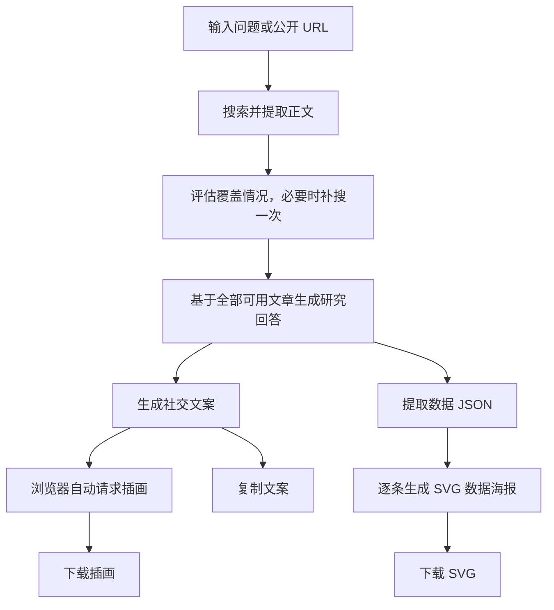

# Insight-to-Post · 从研究问题到社交内容

Insight-to-Post 是一个研究与内容创作工作台。输入问题或公开文章链接，系统会检索并提取文章正文，生成带来源链接的研究回答，再产出 X 文案、社交插画和数据海报，方便核对、复制与下载。

适合围绕行业趋势、技术变化、市场数据等话题收集资料并制作内容初稿。当前版本为本地运行的 Web 应用，支持电脑与手机浏览器。

## 快速启动

### 1. 准备环境

- 安装 Node.js 22 或 24 LTS（包含 npm）。
- 下载或克隆本项目，在项目根目录打开终端。
- 准备千问、Tavily 和 MiniMax 三个服务的有效 API 密钥，并确保账号有对应接口和模型的权限与额度。

千问负责文本与 SVG 生成，Tavily 负责搜索和正文提取，MiniMax 负责插画生成。正常研究及图片生成会调用外部服务并产生用量。

### 2. 配置服务

首次启动时复制配置示例。Windows PowerShell：

```powershell
Copy-Item .env.example .env.local
```

macOS / Linux：

```bash
cp .env.example .env.local
```

如果已有 `.env.local`，直接编辑现有文件，避免覆盖配置。将文件中的以下占位值替换为自己的密钥：

```dotenv
QWEN_API_KEY=填写千问密钥
TAVILY_API_KEY=填写Tavily密钥
MINIMAX_API_KEY=填写MiniMax密钥
```

同时检查 `QWEN_BASE_URL` 是否对应密钥所属的服务。项目通过该地址下的 `/responses` 接口调用模型；更换服务地址时，需要确认其支持 Responses API 和配置的模型名称。完整参数见 [配置示例](./.env.example)。密钥只配置在服务端，不要提交到 Git 或填入浏览器页面。

### 3. 安装并运行

```bash
npm ci
npm run dev
```

打开 [http://localhost:3001](http://localhost:3001)。终端保持运行，按 `Ctrl+C` 停止服务。

需要以生产模式运行时：

```bash
npm run build
npm start
```

Windows 也可以使用启动脚本：

```powershell
# 开发模式：检查配置，缺少依赖时自动安装
powershell -ExecutionPolicy Bypass -File .\start.ps1

# 生产模式：构建后启动
powershell -ExecutionPolicy Bypass -File .\start.ps1 -Production

# 更换端口
powershell -ExecutionPolicy Bypass -File .\start.ps1 -Port 3002
```

脚本也支持从根目录 `key.txt` 中读取上述三个具名密钥并补入 `.env.local`，保留已有有效配置，不打印密钥。已按前面的步骤配置 `.env.local` 时，无需另建 `key.txt`。

手机与电脑处于同一 Wi-Fi 时，可打开启动脚本显示的局域网地址；无法连接时检查电脑防火墙和网络隔离设置。npm 启动命令同样监听局域网，默认端口为 3001。

## 如何使用

1. **输入研究问题。** 支持 5～1000 字，可包含公开文章 URL。写明年份、地区或人群通常更容易得到聚焦的回答，例如“2025 年企业使用生成式 AI 的比例有多高？”。
2. **选择文案长度。** 页面默认选择叙述长文（目标 2000 加权字符），也可选择标准短帖（280 加权字符）。中文通常按 2 个加权字符计算；长帖需要发布账号支持。
3. **开始研究。** 页面依次显示开场文字、检索进度和核心观察，完整段落到达后逐字展示。点击段末的来源域名可打开原文，上方可展开检索词及结果。
4. **查看文案与数据海报。** 研究回答确认后，两者并行生成，完成的内容会先展示。文案成功展示后自动生成一张插画。
5. **调整并导出。** 复制文案，或使用“重新生成文案”“模板二”“模板三”生成新版本；可查看插画提示词、重新生成配图并下载图片。数据海报支持查看提取 JSON、SVG 代码及下载 SVG。

提问区的“数据海报 · 修改提取提示词”允许调整数据提取要求，留空使用默认提示词。它控制从回答中提取什么数据，海报绘制提示词由服务端统一维护。

文案和插画分别保留本次问题的全部成功版本，可用左右按钮、方向键或手机横向滑动切换。复制、依据查看和图片下载对应当前选中版本。切换文案不会自动更换图片；点击“重新生成配图”会根据当前文案生成新图。

**结果只保存在当前页面。** 刷新页面、切换或修改问题会清除结果和版本历史，请及时复制或下载。页面提供演示数据，可先体验展示效果；演示不会自动调用图片 API。

## 功能与实现方式

| 功能 | 使用者看到的结果 | 实现方式 |
| --- | --- | --- |
| 资料检索 | 检索词、文章链接及提取状态 | 千问规划检索词，Tavily 搜索并提取正文；直接提供 URL 时优先提取文章 |
| 研究回答 | 分段核心观察、来源链接及可用指标 | 根据文章正文生成回答，将已知证据编号映射到真实来源 |
| 流式展示 | 开场、进度、回答和文案逐步出现 | 浏览器通过 POST fetch 读取 SSE；完整段落解析后推送并播放文字动画 |
| 社交文案 | 可复制的 X 文案及多个写作版本 | 独立写作调用仅以完成的研究回答正文为素材，支持原模板重生成与另外两套模板 |
| 社交插画 | 竖版图片、提示词和下载入口 | MiniMax `image-01` 生成 3:4 插画，采用 Corporate Memphis / Alegria 风格 |
| 数据海报 | 每条数据对应一张 768 × 1024 SVG | 固定 `qwen3.8-flash` 提取数据 JSON，固定 `qwen3.8-max` 逐条绘制，同时最多处理两张 |
| 取消与失败处理 | 停止等待、保留已确认内容及明确错误 | 取消信号传递至后端；请求身份检查阻止旧请求覆盖新结果 |

### 一次研究如何完成



所有独立成功提取的文章都会保留，来源数量与类别不是生成回答的门槛。搜索摘要不能替代正文；完全无法取得正文时会明确报错。正文提取失败的 URL 会再尝试一次，已成功的文章不会重复提取；根据首轮正文覆盖情况最多补搜一次。

社交文案重生成复用已完成研究的签名快照，不重复搜索，快照有效期为两小时。文案和数据海报独立完成，某张海报失败不影响其他条目或已完成文案；没有可提取数据时显示空结果。数据海报没有自动重试或替代图片。

插画失败通常最多自动重试一次，使用相同提示词；配置、鉴权、余额错误及取消不重试。重写文案不会自动重新配图，也不会清除已有图片。

### 内容校验与使用边界

当前默认 `REPORT_CORE_VALIDATION=false`，研究回答不执行严格内容校验或自动重生成，但仍要求存在文章正文、模型返回完整可解析的 JSON 和可显示正文。已知引用会链接到真实文章，无法定位的引用会省略标签。**有来源链接不等于内容已经逐项核实**，发布前仍需核对数字、日期、统计口径和结论。

设置 `REPORT_CORE_VALIDATION=true` 可启用回答结构、引用及数字依据等本地检查，并在必要时重生成一次研究回答。该开关不改变社交文案的一次调用规则；文案始终不做逐段事实验证，超长时提示，不自动截断。

SVG 会检查静态图形边界，拒绝脚本、事件与外链，并通过图片元素展示；此检查不核验图中文字或统计含义。当前没有直接发布到 X、登录账户、数据库历史记录或跨设备同步功能。

## 项目架构

项目使用 Next.js App Router、React、TypeScript 和 Tailwind CSS。前后端位于同一个项目，后端由纯业务规则、业务服务和显式工作流组成，不依赖专门的 Agent SDK。

```text
src/
  app/                      页面入口及 API 路由
  components/               回答、文案、图片、海报与来源展示
  client/                   请求生命周期、SSE 解析、逐字动画与演示数据
  core/                     数据契约和纯业务规则
  server/
    prompts.ts              全部模型指令、输入序列化与重试提示
    providers/              千问、Tavily、MiniMax 的协议适配
    services/               检索、报告、文案、图片、海报与签名快照
    workflow/
      state.ts              工作流状态与能力契约
      nodes.ts              执行步骤，返回状态更新
      edges.ts              根据状态选择下一步
      run.ts                服务组装与工作流执行
    http.ts                 请求校验、并发限制、JSON / SSE 响应
    logger.ts               服务端结构化日志
    runtime.ts              错误、取消与模型 JSON 处理
```

`core` 不读取环境、不联网、不依赖 UI 或服务端；浏览器代码不导入 `server`。供应商适配只处理协议，服务不引用工作流，实际服务仅在 `workflow/run.ts` 组装。节点返回状态更新，执行器负责合并，边只负责选择下一步。

调整模型指令时修改 [prompts.ts](./src/server/prompts.ts)；调整引用或业务规则时修改 `core`；调整执行顺序时修改工作流节点与边。详细流程和扩展约定见 [项目架构说明](./docs/architecture.md)。

### API 概览

| 接口 | 主要输入 | 用途 |
| --- | --- | --- |
| `POST /api/analyze` | `idea`，可选 `socialTargetLength`（280 / 2000）、`dataExtractionPrompt`（最多 2000 字符） | 研究、社交文案及数据海报 |
| `POST /api/social-content` | `socialRetryToken`，可选 `template`（2 / 3） | 复用研究结果生成文案，不传模板则重放原提示词 |
| `POST /api/social-image` | `text`（最多 1200 字符） | 根据当前文案生成插画 |

分析和文案接口默认返回 JSON；添加 `Accept: text/event-stream` 可使用 SSE 获取进度与内容。插画由浏览器另外请求，不包含在分析接口的自动执行链内。

## 常用配置

修改 `.env.local` 后重启服务。下列为当前项目默认值，完整列表见 [.env.example](./.env.example)。

| 配置 | 默认值 | 用途 |
| --- | --- | --- |
| `QWEN_MODEL` | `qwen3.8-flash` | 检索规划、覆盖评估及社交写作 |
| `QWEN_REPORT_MODEL` | `qwen3.8-max` | 研究回答 |
| `QWEN_OPENING_MODEL` | `qwen3.8-flash` | 流式开场 |
| `REPORT_CORE_VALIDATION` | `false` | 是否启用严格报告校验 |
| `QWEN_TIMEOUT_MS` | `150000` | 单次千问调用超时，毫秒 |
| `TAVILY_TIMEOUT_MS` | `60000` | Tavily 请求超时，毫秒 |
| `MINIMAX_TIMEOUT_MS` | `120000` | MiniMax 请求超时，毫秒 |
| `X_TARGET_LENGTH` | `280` | 未显式指定长度时的服务端目标值；页面会传入所选长度 |
| `SOCIAL_SNAPSHOT_SECRET` | 未设置 | 可选独立签名密钥；缺失时使用服务端千问密钥 |

数据海报使用固定模型，不随 `QWEN_MODEL` 或 `QWEN_REPORT_MODEL` 改变。

## 常见问题

| 情况 | 处理方法 |
| --- | --- |
| 端口 3001 已被占用 | 使用 `npm run dev -- --port 3002`，或启动脚本的 `-Port 3002` 参数 |
| 提示配置缺失、鉴权失败或额度不足 | 检查对应服务的密钥、地址、模型权限和余额，修改配置后重启 |
| 部分文章提取失败 | 其他成功文章仍可用于研究；若全部失败，换用可公开访问的 URL 或更具体的问题 |
| 生成时间较长或超时 | 查看页面阶段与服务端日志；响应速度取决于外部服务和网络，可取消后重试 |
| 无法自动复制 | 使用页面提供的手动全选复制；局域网 HTTP 环境可能限制剪贴板权限 |
| 文案生成成功，但插画报长度错误 | 配图接口最多接受 1200 字符文案，完整提示词也有长度限制；可选择标准短帖重新研究，系统不会偷偷截断内容 |
| 文案重生成提示已过期 | 签名快照有效期为两小时，需要重新研究 |
| 取消后仍显示部分结果 | 已确认的回答与已完成内容会保留，未确认的流式预览会撤回 |

日志在启动服务的终端中显示，每行一个 JSON，可按 `runId` 追踪同一次任务的步骤、耗时和用量。日志不输出密钥、签名 token、正文全文或图片 base64。

## 开发与验证

业务或代码修改后，可执行：

```bash
npm test
npm run typecheck
npm run build
```

UI 模拟验证按功能选择：

```bash
npm run test:ui
npm run test:ui:social
npm run test:ui:answer
npm run test:ui:image
npm run test:ui:stream
npm run test:ui:data
```

以上测试使用模拟响应。`npm run verify:live`、`npm run verify:image` 及 `node scripts/verify-ui-observations.mjs` 会调用真实服务并产生用量，不属于快速启动的必要步骤。现有图片示例可查看 [配图示例](./artifacts/social-image-example/README.md)。

进一步阅读：[架构与演进约定](./docs/architecture.md)、[回答与提示词检查](./docs/answer-prompt-audit.md)、[验收记录](./验收记录.md)。验收记录和历史材料描述当时的实现，当前功能以代码为准。

---

## 原 README（保留的详细说明与历史记录）

以下完整保留替换前的 README，包含详细实现说明、实验规则与历次验证记录。快速启动和当前使用方式请优先阅读本文前半部分；带日期的记录描述当时的实现。

# Insight-to-Post · 研究观察与社交文案

输入问题，千问规划检索词，Tavily 搜索并提取文章，按段落呈现有信源的回答，再生成可一键复制的 X 文案；首次文案完成后自动生成一张插画，等待时在下方显示转圈动效，完成后可下载。重新生成文案或配图会保留全部成功版本，自动选中新版本，可通过左右按钮、方向键或手机横向滑动切换；生成中与失败时保留原版本。复制、依据、提示词与下载对应当前选择，点击“重新生成配图”根据当前选中的文案生成新图。历史仅保存在当前页面，切换问题或刷新页面会清除。

## 当前实验分支（2026-10-09）

`main` 已合并 `codex/research-data-posters` 的自动数据海报：研究回答完成后，立即并行启动社交文案与数据海报子流程。海报先用固定 `qwen3.8-flash` 从完整研究回答提取全部独立数据观察，返回去重的简短文案 JSON 数组；然后每条单独调用固定 `qwen3.8-max` 输出 768 × 1024 静态 SVG。海报请求最多同时运行两条，全部条目均会处理，不设置条目数量上限。每张完成后立即展示，可查看提取 JSON、SVG 代码并下载 SVG；社交文案完成后也立即展示，无需等待海报结束。

提问区可展开“数据海报 · 修改提取提示词”，编辑提示词 1；留空使用“从此问答中提取出包含具体数据的内容，不要重复，json输出”。提示词 2 在 `server/prompts.ts` 保持用户原文固定，仅将末尾研究内容数字字段替换为当前 JSON 条目的文案。新流程没有自动重试、失败兜底或替代图片：提取错误在板块显示，单张模型或 SVG 错误在对应条目显示，其他条目继续。没有数据时明确显示空结果。取消停止在途和排队任务，保留已完成内容；切换问题清除旧结果。SVG 只允许静态原生图形与文字，以图片元素隔离展示，拒绝脚本、事件、外链等。此检查不代表已核验图中文字或统计含义，发布前仍需对照文案。

`main` 同时保留 `codex/social-opening-stream` 的开场与社交文案流式展示，延续默认关闭核心报告的全部内容校验：`REPORT_CORE_VALIDATION=false`（未设置也关闭）。段落长度、首答/要点/结论布局、引用完整性、数字依据、指标卡锚点和旧套话过滤均不作为发布门槛；跳过整篇校验与回答重生成，报告只请求一次。模型仍使用 `qwen3.8-max`，继续按完整段落播放逐字动画，播完后显示信源标签。

关闭模式仍解析完整 JSON、处理取消与断流，完全没有文章正文或模型没有返回可显示正文时明确报错。已知来源和证据编号仍映射到真实文章；无法定位的引用只省略标签，不删除正文。设置 `REPORT_CORE_VALIDATION=true` 可恢复下面的严格报告规则。

社交文案也不执行内容校验：独立写作模型只接收已完成研究简报的完整正文，理解后按社交风格重新组织表达。首次与手动重生成均只调用一次，不追加校验纠错。后台只解析可显示文字并保留简报依据；数字、引用编号、段数和长度不阻断返回，超长仅提示。请求失败、损坏 JSON 或空文案时显示生成失败，保留简报与重试入口；已删除将简报拆段作为成功文案的旧兜底，失败不会触发配图。

## 严格模式输出规则（2026-10-08）

- 参考本地 Morphic 的问题导向检索：模型先将问题改写为语义关键词，Tavily advanced 搜索最多返回 15 个结果；全部缺失正文的 URL 按每批 20 个补取，对仍失败或内容不可用的 URL 再提取一次，不重复请求已成功的文章。根据已提取正文能否覆盖问题决定是否补搜一次，不再按少于五篇触发。用户直接提供公开 URL 时先提取文章。规划失败用原问题检索，覆盖评估失败保留文章继续回答。
- 核心内容按参考图展示：加粗首答、带加粗标题的要点列表、建议和结论。每段结尾显示该段实际引用的灰色域名胶囊，点击直接在新标签页打开原文；上方可展开查看检索词及结果，不再单独展示下方的研究来源列表。所有提取文章仍保留在报告数据中，不将未支持该段的文章自动贴为段末引用。
- 首答独立于详细内容：1–2 句结论和关键限定，通常 40–90 字、最多 120 字符，不带要点标题或换行；数据、行业案例、年份及原因链放入下方要点。每次报告必须包含首答、带标题的要点和末尾结论，不接受只有首答。相关建议由模型按问题给出，指标卡仍可省略。
- 正文来源数量和类型不设输出门槛；有一篇可用文章也生成完整回答。完全未取得正文时明确报错，不用检索说明冒充研究报告或生成对应社交文案。
- 全部成功提取的文章均进入报告与文案引用；一个段落可以引用多个来源。独立提取的镜像文章也保留各自引用，同一来源的重复引用不增加文章数。
- 不再只挑 8 篇或只为模型保留 10 篇文章。核心观察先直接回答用户问题，再解释理由与必要限定；`answerBlocks` 保留各段的呈现方式和引用，`summary[0]` 保留完整纯文字供既有社交逻辑使用。不区分或展示事实／推断等回答标签。缺少的引用只补入依据元数据，不向正文插入文章标题或摘录。
- 模型只为回答选择相关依据，不再被要求把全部文章塞进一段话。报告不调用模型语义复核。生成请求失败、结构不完整或任意回答段落被本地校验移除时，携带原始问题、全部正文与失败原因重生成一次并重新校验。工作流总共最多两次报告生成，不叠加服务内部格式重试；失败输出的已知 token 用量也计入诊断。第二次仍失败则返回受控错误，不发布残缺报告、万能套话或对应社交文案。
- 核心回答的资料输入只发送正文片段与对应编号，加上用户问题；来源标题、作者、网址、类别等元数据不进入该提示词。来源信息仍由后台保留，用于页面展示和引用定位。
- 社交写作节点的内容输入只接收页面“核心观察”的完整正文（`report.summary[0].text`）与写作风格，不混入指标卡或原始问题；文章标题、URL、原文引用留在后台依据层。模型未完成时显示文案失败，不复制简报填充文案。
- 当前实验社交写作没有本地内容校验、模型复核或自动纠错，只生成一次。后台解析 JSON 段落文字，模型不需要输出引用编号；简报依据作为整体元数据保留，不声称逐段核验。
- 来源失败提示仅指对应文章 URL 未取得可用正文，不表示整份报告失败；提取重试后仍失败的文章排除在事实和数字依据之外，已成功的独立文章全部保留。
- 结尾表达交给模型，不强制问句或问号。复制保留纯文字、段落及空行。
- 优先尝试按所选长度生成；完整引用与长度冲突时保留文案、提示超长，复制后自行调整，不截断或清空。

## 启动

需要 Node.js 22/24 LTS、npm 和千问、Tavily、MiniMax 三个服务的有效密钥。配置 key.txt：

    QWEN_API_KEY=自己的千问密钥
    TAVILY_API_KEY=自己的Tavily密钥
    MINIMAX_API_KEY=自己的MiniMax密钥

Windows 在项目目录运行：

    powershell -ExecutionPolicy Bypass -File .\start.ps1 -Production

脚本识别服务密钥并填入缺失的 .env.local，保留已有配置，不打印密钥。也可从 .env.example 配置后 npm ci、npm run dev。

默认访问 [本机页面](http://localhost:3001/)。手机同 Wi-Fi 可用启动脚本显示的局域网地址；start.ps1 -Port 3002 可换端口。HTTP 环境无法自动复制时提供手动全选。

## 架构与接口

当前采用纯业务规则、服务适配和显式工作流：

- `src/core`：数据契约、来源、证据、报告与文案的纯规则。
- `src/server`：供应商协议、模型提示词、业务服务、HTTP 边界。
- `src/server/workflow`：`state.ts` 声明状态和能力契约，`nodes.ts` 放独立节点函数，`edges.ts` 管理转移，`run.ts` 组装并执行。
- `src/client`：请求生命周期与演示数据；页面与组件负责交互和展示。

节点返回更新，由执行器合并状态。边只读取状态；可用来源与覆盖按需计算。详细目录、流程图、删除记录和扩展位置见 [架构与演进约定](./docs/architecture.md)。旧 `src/lib` 已迁移删除，无兼容转发层。

当前实验默认流程：问题 → 检索词规划 → Tavily Search / 必要时 Extract → 正文覆盖评估 / 必要时补搜一次 → 保留全部可用文章 → 千问分段回答及展示字段解析 → 保留文章依据 → 根据完整简报独立生成社交文案 → 展示模型文案或明确失败。严格模式在报告生成后增加本地校验及必要时重生成，不改变社交写作的一次调用规则。

POST /api/analyze 输入 idea（5～1000 字）及可选 socialTargetLength（280 / 2000）。报告覆盖数量是已提取和实际引用文章数，不是达标门槛。诊断含搜索、补取、credits、模型调用、token 与耗时。

该接口另接收可选 `dataExtractionPrompt`（最多 2000 字符）。SSE 新增 `data-posters`（提取状态和各条海报状态）与 `social`（独立完成的文案和重生成 token）事件；最终 SSE / JSON 结果包含 `dataPosters`，诊断累计两条分支的模型调用和 token，另记录 `dataPostersDurationMs`。海报失败不清空研究报告或文案，最终状态为 partial。

页面默认使用分阶段流式返回：发送 `Accept: text/event-stream`，通过 POST fetch 读取 SSE。研究开始前，独立调用 `QWEN_OPENING_MODEL`（默认 `qwen3.8-flash`），关闭思考、最多 160 输出 token；短提示词要求先接话，再拆成两个关注点，共 60 字内、不下结论。收到文字增量立即用 `opening` 事件展示，开场结束后才执行原工作流。开场只用于展示，不进入研究状态、检索词、报告、文案或签名快照；后续仍只处理用户原始问题。开场调用一次，无自动重试、替代话术或失败兜底，失败直接返回受控错误。

报告使用独立的 `QWEN_REPORT_MODEL`（默认 `qwen3.8-max`），输出预算仍为 7000 token。开场继续使用独立 flash 模型，检索和文案沿用 `QWEN_MODEL`。流式报告在服务端增量解析 JSON，每个完整段落解析展示字段并映射信源后发送给浏览器；未闭合的段落不展示。默认不执行内容检查；启用严格模式后才检查段落结构、引用与数字，并允许整篇重生成一次。

后续事件包括 `progress`（实际工作流阶段）、`report-start`（本轮编号、公开信源与 `coreValidation` 模式）、`report-block`（完整段落）、`report`（完整核心观察、指标和公开来源）、`result`（完整报告与文案）。浏览器将段落排队播放逐字动画，播完该段才显示信源标签；通常每 20 毫秒一个字，长段落加快到约 5 秒内完成，遵循系统减少动态效果设置。默认显示“正在生成正文”，不会宣称已通过校验；严格模式显示对应校验状态。流开始后失败用 `error` 事件返回，输入错误与并发超限仍使用 HTTP JSON 错误。流每 15 秒发送注释心跳；不公开上游原始 JSON、思考或工具事件。未声明 SSE 的调用继续返回原 JSON，不执行展示用的开场或段落预览。

首字目标为点击后 2 秒内展示模型文字，不用固定占位话术冒充首字。服务端 `opening.firstToken` 日志记录模型调用到首段文字的耗时，`opening.completed` 单独记录 token 用量；原研究诊断中的模型调用数与 token 统计保持原口径，总耗时包括开场。真实首字延迟受供应商和网络影响，需真实 API 实测；模拟 UI 验证只证明浏览器收到片段即可在两秒内展示。

段落预览与正式报告分开保存；解析失败、断流或确认前取消时撤掉预览，不生成文案或配图。严格模式重生成时清空第一轮播放队列，再播放第二轮。最终 `report` 确认与预览一致时，播完队列再切换到正式报告；如最终整理发生差异，以正式报告为准。文案只接收完成报告的正文，完成后补入复制操作并自动生成配图；确认报告后的失败或取消保留观察并说明文案未完成。切换问题清除旧结果，请求身份与生成轮次共同阻止迟到事件恢复旧内容。浏览器取消与断开连接会取消后端任务；流式与 JSON 请求共用同一并发额度，任务结束后释放。

首次社交写作在报告确认后发送 `social-start`，根 `paragraphs` 数组中的完整文字段落经相同纯文字整理后发送 `social-block`（`index / text`）；空段落跳过，不公开原始 JSON、思考或引用元数据。浏览器按顺序逐字播放，最终 `result` 确认不跳过尚未播放的文字；全文成功并播完后开放复制及首次配图。失败、取消与断流撤掉预览，保留已确认简报。开场与文案通常每 20 毫秒播放一个字，长文本加快到约 5 秒，遵循系统减少动态效果设置。

POST /api/social-content 接收服务器签名的 socialRetryToken，两小时有效，复用全部文章及已保留观察，只重试文案，不重复检索。声明 `Accept: text/event-stream` 时同样发送 `social-start / social-block`，以 `social-result` 确认全文和用量；未声明时保留 JSON 返回。重生成的预览独立于已有版本，成功且播完后添加新版本并选中；失败不添加版本，保留已有文案和图片。每接口单进程并发上限 2，两种传输共用额度；取消与新问题阻止旧结果重新出现。结果只保存在当前页面。

POST /api/social-image 接收 `{ "text": "当前社交文案" }`，返回 `image`（`dataUrl / prompt / model / generatedAt`）、`attempts`、`durationMs`。首次可用社交文案完成后，浏览器自动请求配图，使用 MiniMax `image-01`，固定 `n=1`、aspect_ratio=3:4（竖版）、base64 返回及关闭自动提示词优化。提示词明确采用“Corporate Memphis”和“Alegria”插画风格、扁平化矢量艺术、极简几何图形。配图区域下方显示转圈和等待提示，成功或失败后移除；遵循系统减少动态效果设置。页面可以查看提示词、下载图片、重新生成或失败后手动重试。重写文案保留已有图片与进行中的配图请求，不自动重新配图；“重新生成配图”按钮按当前选中的可用文案请求新图，文案重写中或没有可用文案时禁用。切换问题会清除旧图并取消未完成请求。演示数据和首次未完成的文案不会调用图片 API。

图片生成失败最多自动重试一次，使用完全相同的提示词；配置、鉴权、余额错误和取消直接返回。除此之外不做图片兜底、不替换供应商或插入占位图。按 [MiniMax 官方协议](https://platform.minimax.cn/docs/api-reference/image-generation-t2i)，提示词最多 1500 字符；当前配图接口接受最多 1200 字符的文案，序列化后的完整提示词超过上限时明确报错，不截断文案。图片以 base64 在浏览器展示和下载，无临时远程链接依赖。

首次分析将完整的原始文案提示词保存在服务器签名快照中。点击“重新生成文案”时，将该提示词原封不动发送给同一模型，只生成一次，不追加纠错提示、不自动修稿。报告、结论编号与所选长度保留；生成失败时显示原因。

文案区的“模板二”和“模板三”按钮点击后基于同一份研究简报生成新版本：两者使用用户指定的简短写作要求及带 `claimIds` 的 JSON 输出格式，模板二包含阿里 RSI 的参考文案，模板三不含参考文案。后台继续展示段落文字并沿用研究简报依据。首次生成与“重新生成文案”仍使用原模板；新模板各调用一次，无自动重试或兜底。`POST /api/social-content` 可选传入 `template: 2 / 3`，不传则重放原提示词。

三套文案模板均通过 Responses API 的 `instructions` 单独声明 JSON 输出协议，区分 `text` 字段中的纯文字与外层 JSON 包装；模板正文及重放提示词保持原文。文案失败日志记录请求、JSON 或段落解析阶段；无效 JSON 和无效段落分别提示原因，不自动修复或把纯文字当作成功 JSON。

## 大模型调用与 prompt 管理

所有模型指令、JSON 输入序列化和重试提示统一维护在 [src/server/prompts.ts](./src/server/prompts.ts)。当前实际调用点如下：

| 调用位置 | Prompt 构建函数 | 输入 | 重试行为 |
| --- | --- | --- | --- |
| `src/server/services/opening.ts` → `streamOpening` | `openingPrompt` | 用户原始问题 | 只调用一次，无重试或兜底；输出仅流式展示 |
| `src/server/services/research.ts` → `researchWithTavily` | `searchQueryPrompt` | 用户问题、上海时区当前日期 | 失败用原始问题继续搜索 |
| `src/server/services/research.ts` → `researchWithTavily` | `searchReviewPrompt` | 用户问题、检索词、正文片段和提取状态 | 只评估首轮；有缺口补搜一次，失败保留文章 |
| `src/server/services/report.ts` → `generateReport` | `reportPrompt` | 用户问题、来源正文片段、可选校验反馈 | 默认实验模式只生成一次，无校验修稿；严格工作流首次和补写各一次；服务独立调用默认严格模式，最多一次格式修复 |
| `src/server/services/social.ts` → `generateSocialContent`（生成） | `socialContentPrompt` | 完整核心观察正文、写作风格、目标长度 | 只生成一次，无内容校验、自动纠错或简报复制兜底 |
| `src/server/services/data-posters.ts` → `generateDataPosters`（提取） | `dataExtractionPrompt` | 完整核心观察正文、可选提示词 1 | Flash 只调用一次，失败直接显示 |
| `src/server/services/data-posters.ts` → `generateDataPosters`（逐条海报） | `dataPosterPrompt` | 一条提取文案、固定提示词 2 | 每条 Max 只调用一次，失败直接显示，其他条目继续 |
| `src/server/services/image.ts` → `generateSocialImage` | `socialImagePrompt` | 当前社交文案全文 | 同一提示词最多请求两次，每次只生成一张 |

职责边界：业务模块准备数据、执行校验、控制重试与兜底；prompt 模块只导入数据类型，构建字符串；`server/providers/qwen.ts` 处理模型配置、HTTP、超时与错误。修改指令只需修改 `prompts.ts`，不需要调整调用层。文案 prompt 只接收观点，不接收来源正文或引用元数据。

本次空泛回答的定位、完整 prompt 组成和修改说明见 [回答与提示词检查](./docs/answer-prompt-audit.md)。

新增模型调用时，在 `prompts.ts` 定义具名输入类型和构建函数，调用层使用 `callQwen(promptBuilder(input), …)`，不要在调用层拼接指令或重试提示。`tests/prompts.test.ts` 检查所有生产 `callQwen` 调用使用集中构建函数，并检查 prompt 模块没有运行时依赖。

## 运行日志

启动或重启服务后，在运行 `npm run dev`、`npm start` 或 `start.ps1` 的服务端终端查看日志。日志默认启用，每行一个 JSON，包含 `timestamp`、`level`、`scope`、`event` 和 `runId`；按同一个 `runId` 可追踪一次分析中各节点及服务的日志。独立重生成文案和配图各自使用新的运行 ID。

`workflow` 记录每个实际执行节点的开始、完成、转移、失败或取消及耗时；`research` 记录检索词规划、搜索、正文提取和覆盖评估；`report`、`social` 和 `image` 记录模型尝试、校验、重试与兜底。正常为 `info`，校验失败、重试及业务兜底为 `warn`，向调用方抛出的失败为 `error`，取消单独标记为 `cancelled`。日志只输出数量、长度、用量及受控错误码，不记录密钥、签名 token、提示词、正文、文案全文、图片 base64 或上游原始错误。浏览器开发者控制台不显示这些服务端日志。

## 验证与交付

    npm test
    npm run typecheck
    npm run build
    npm run test:ui
    npm run test:ui:social
    npm run test:ui:answer
    npm run test:ui:image
    npm run test:ui:stream
    npm run test:ui:data
    node scripts/verify-ui-observations.mjs

最后一项调用真实 API，会产生服务用量。其余测试使用模拟响应，覆盖检索词改写、按覆盖补搜、批量提取与失败 URL 重试、分段引用直达原文，以及 prompt 集中管理、少量来源、单一类型、全部 12 篇文章、完整回答检查、请求失败或段落被移除后重生成一次、重试失败或无正文的受控错误、事实校验、取消、复制及签名保护。2026-10-08 本轮 136 项测试、类型检查、生产构建和五项 UI 验证通过，未调用真实 API。此前实测见 [验收记录](./验收记录.md)。

2026-10-09 段落流式实验分支：144 项测试、类型检查、生产构建及五项 UI 验证通过。新增验证覆盖完整段落校验后即时推送、逐字播放结束才显示信源、整篇确认不中断播放、失败重生成清空队列、过期事件、取消与断流、减少动态效果，以及独立报告模型配置。全部使用模拟 API；尚未实测 `qwen3.8-max` 的响应速度和报告通过率。

2026-10-09 关闭核心校验的后续改动：149 项测试、类型检查、生产构建及五项 UI 验证通过。补测超长首答/标题、缺少引用/要点/结论、无锚点数字与指标、未知引用仅省略标签、跳过校验与重生成、公开入口默认关闭及显式恢复、长正文签名快照、空正文/损坏 JSON/断流错误，以及两种模式的逐字播放和手机布局。验证使用模拟响应，未调用真实 API。

2026-10-09 社交文案修复：运行日志确认旧文案校验失败后触发了复制简报的兜底。现已关闭生产文案内容校验与自动纠错、删除该兜底；155 项测试、类型检查、生产构建及五项 UI 验证通过。新增覆盖完整简报作为独立写作输入、模型改写直接展示、单次调用、解析失败保留简报与签名重试、无文案时不生成配图，以及成功重试与历史版本保留。验证使用模拟响应，未新增真实 API 调用。

2026-10-09 数据海报：168 项测试、类型检查、生产构建及六项 UI 验证通过。新增验证覆盖 Flash JSON 提取、Max 逐条生成、固定提示词 2、提示词 1 编辑、全部条目与有限并发、两条分支独立发布和用量、失败直显无重试、空数据、SVG 静态边界、实际图片渲染和下载、320px 布局、取消及过期事件。验证使用模拟响应，未调用真实 API。

2026-10-09 主分支合并：174 项测试、类型检查、生产构建及六项 UI 验证通过。保留主分支的开场、社交段落流式和逐字播放，合并数据海报的并行生成与即时完成事件；验证文案播放在海报等待期间独立完成，失败立即停止预览并显示错误。验证使用模拟响应，未调用真实 API。

图片真实验证（会产生 MiniMax 用量）：`npm run verify:image`。默认使用专门编写的演示文案；也可以 `npm run verify:image -- path/to/social.txt` 使用自己的文案文件。该脚本与页面调用同一工作流入口，保存文案、完整提示词、单张图片和调用记录到 [artifacts/social-image-example](./artifacts/social-image-example/README.md)。已保存的示例无需再次调用 API 即可查看；后续执行验证会更新这个示例目录。

[开发计划](./MVP开发计划.md)、[设计说明原稿](./设计决策说明.md)、[两页设计 PDF](./output/pdf/设计决策说明-v02.pdf)。旧规则保存在 docs/history；旧演示不代表当前引用政策。真实手机人工检查仍待确认。

平台直接发布、其他图表模板、登录、数据库、PWA 和公网托管仍暂缓。正文当前采用完整段落到达后的逐字播放，实验默认不进行核心内容校验。原文、翻译和推断仍可人工核验；不声称模型或来源绝对正确。
