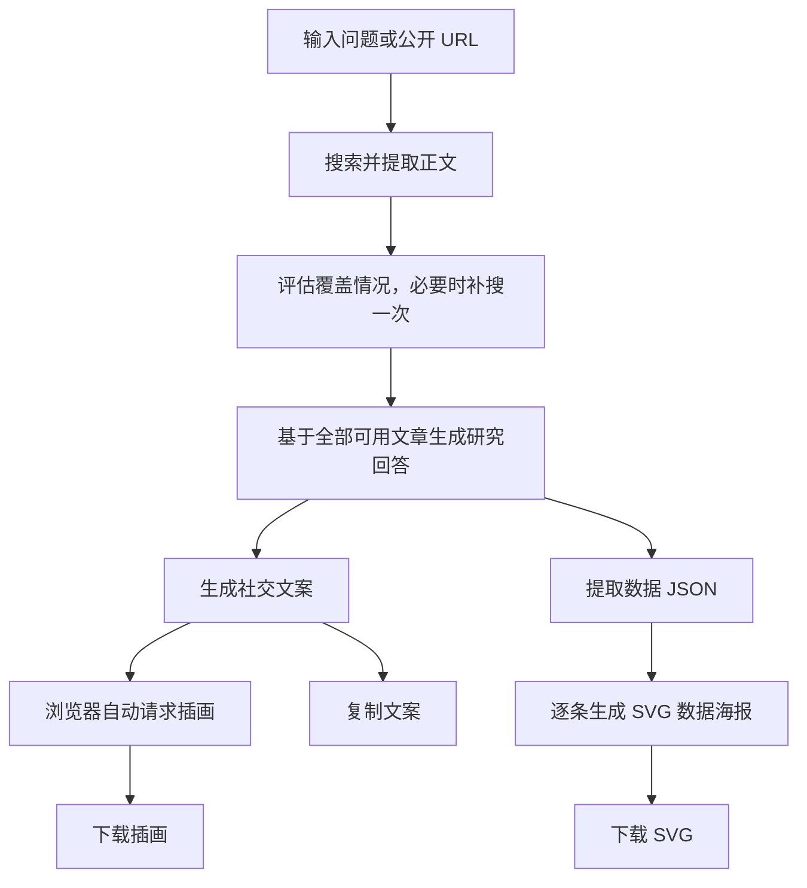

# Insight-to-Post · 从研究问题到社交内容

Insight-to-Post 是一个研究与内容创作工作台。输入问题或公开文章链接，系统会检索并提取文章正文，生成带来源链接的研究回答，再产出 X 文案、社交插画和数据海报，方便核对、复制与下载。

适合围绕行业趋势、技术变化、市场数据等话题收集资料并制作内容初稿。当前版本为本地运行的 Web 应用，支持电脑与手机浏览器。

## 快速启动

### 1. 准备环境

- 安装 Node.js 22 或 24 LTS（包含 npm）。
- 下载或克隆本项目，在项目根目录打开终端。
- 准备千问、Tavily 和 MiniMax 三个服务的有效 API 密钥，并确保账号有对应接口和模型的权限与额度。

千问负责文本与 SVG 生成，Tavily 负责搜索和正文提取，MiniMax 负责插画生成。正常研究及图片生成会调用外部服务并产生用量。

### 2. 配置服务

首次启动时复制配置示例。Windows PowerShell：

```powershell
Copy-Item .env.example .env.local
```

macOS / Linux：

```bash
cp .env.example .env.local
```

如果已有 `.env.local`，直接编辑现有文件，避免覆盖配置。将文件中的以下占位值替换为自己的密钥：

```dotenv
QWEN_API_KEY=填写千问密钥
TAVILY_API_KEY=填写Tavily密钥
MINIMAX_API_KEY=填写MiniMax密钥
```

同时检查 `QWEN_BASE_URL` 是否对应密钥所属的服务。项目通过该地址下的 `/responses` 接口调用模型；更换服务地址时，需要确认其支持 Responses API 和配置的模型名称。完整参数见 [配置示例](./.env.example)。密钥只配置在服务端，不要提交到 Git 或填入浏览器页面。

### 3. 安装并运行

```bash
npm ci
npm run dev
```

打开 [http://localhost:3001](http://localhost:3001)。终端保持运行，按 `Ctrl+C` 停止服务。

需要以生产模式运行时：

```bash
npm run build
npm start
```

Windows 也可以使用启动脚本：

```powershell
# 开发模式：检查配置，缺少依赖时自动安装
powershell -ExecutionPolicy Bypass -File .\start.ps1

# 生产模式：构建后启动
powershell -ExecutionPolicy Bypass -File .\start.ps1 -Production

# 更换端口
powershell -ExecutionPolicy Bypass -File .\start.ps1 -Port 3002
```

脚本也支持从根目录 `key.txt` 中读取上述三个具名密钥并补入 `.env.local`，保留已有有效配置，不打印密钥。已按前面的步骤配置 `.env.local` 时，无需另建 `key.txt`。

手机与电脑处于同一 Wi-Fi 时，可打开启动脚本显示的局域网地址；无法连接时检查电脑防火墙和网络隔离设置。npm 启动命令同样监听局域网，默认端口为 3001。

## 如何使用

1. **输入研究问题。** 支持 5～1000 字，可包含公开文章 URL。写明年份、地区或人群通常更容易得到聚焦的回答，例如“2025 年企业使用生成式 AI 的比例有多高？”。
2. **选择文案长度。** 页面默认选择叙述长文（目标 2000 加权字符），也可选择标准短帖（280 加权字符）。中文通常按 2 个加权字符计算；长帖需要发布账号支持。
3. **开始研究。** 页面依次显示开场文字、检索进度和核心观察，完整段落到达后逐字展示。点击段末的来源域名可打开原文，上方可展开检索词及结果。
4. **查看文案与数据海报。** 研究回答确认后，两者并行生成，完成的内容会先展示。文案成功展示后自动生成一张插画。
5. **调整并导出。** 复制文案，或使用“重新生成文案”“模板二”“模板三”生成新版本；可查看插画提示词、重新生成配图并下载图片。数据海报支持查看提取 JSON、SVG 代码及下载 SVG。

提问区的“数据海报 · 修改提取提示词”允许调整数据提取要求，留空使用默认提示词。它控制从回答中提取什么数据，海报绘制提示词由服务端统一维护。

文案和插画分别保留本次问题的全部成功版本，可用左右按钮、方向键或手机横向滑动切换。复制、依据查看和图片下载对应当前选中版本。切换文案不会自动更换图片；点击“重新生成配图”会根据当前文案生成新图。

**结果只保存在当前页面。** 刷新页面、切换或修改问题会清除结果和版本历史，请及时复制或下载。页面提供演示数据，可先体验展示效果；演示不会自动调用图片 API。

## 功能与实现方式

| 功能 | 使用者看到的结果 | 实现方式 |
| --- | --- | --- |
| 资料检索 | 检索词、文章链接及提取状态 | 千问规划检索词，Tavily 搜索并提取正文；直接提供 URL 时优先提取文章 |
| 研究回答 | 分段核心观察、来源链接及可用指标 | 根据文章正文生成回答，将已知证据编号映射到真实来源 |
| 流式展示 | 开场、进度、回答和文案逐步出现 | 浏览器通过 POST fetch 读取 SSE；完整段落解析后推送并播放文字动画 |
| 社交文案 | 可复制的 X 文案及多个写作版本 | 独立写作调用仅以完成的研究回答正文为素材，支持原模板重生成与另外两套模板 |
| 社交插画 | 竖版图片、提示词和下载入口 | MiniMax `image-01` 生成 3:4 插画，采用 Corporate Memphis / Alegria 风格 |
| 数据海报 | 每条数据对应一张 768 × 1024 SVG | 固定 `qwen3.8-flash` 提取数据 JSON，固定 `qwen3.8-max` 逐条绘制，同时最多处理两张 |
| 取消与失败处理 | 停止等待、保留已确认内容及明确错误 | 取消信号传递至后端；请求身份检查阻止旧请求覆盖新结果 |

### 一次研究如何完成



所有独立成功提取的文章都会保留，来源数量与类别不是生成回答的门槛。搜索摘要不能替代正文；完全无法取得正文时会明确报错。正文提取失败的 URL 会再尝试一次，已成功的文章不会重复提取；根据首轮正文覆盖情况最多补搜一次。

社交文案重生成复用已完成研究的签名快照，不重复搜索，快照有效期为两小时。文案和数据海报独立完成，某张海报失败不影响其他条目或已完成文案；没有可提取数据时显示空结果。数据海报没有自动重试或替代图片。

插画失败通常最多自动重试一次，使用相同提示词；配置、鉴权、余额错误及取消不重试。重写文案不会自动重新配图，也不会清除已有图片。

### 内容校验与使用边界

当前默认 `REPORT_CORE_VALIDATION=false`，研究回答不执行严格内容校验或自动重生成，但仍要求存在文章正文、模型返回完整可解析的 JSON 和可显示正文。已知引用会链接到真实文章，无法定位的引用会省略标签。**有来源链接不等于内容已经逐项核实**，发布前仍需核对数字、日期、统计口径和结论。

设置 `REPORT_CORE_VALIDATION=true` 可启用回答结构、引用及数字依据等本地检查，并在必要时重生成一次研究回答。该开关不改变社交文案的一次调用规则；文案始终不做逐段事实验证，超长时提示，不自动截断。

SVG 会检查静态图形边界，拒绝脚本、事件与外链，并通过图片元素展示；此检查不核验图中文字或统计含义。当前没有直接发布到 X、登录账户、数据库历史记录或跨设备同步功能。

## 项目架构

项目使用 Next.js App Router、React、TypeScript 和 Tailwind CSS。前后端位于同一个项目，后端由纯业务规则、业务服务和显式工作流组成，不依赖专门的 Agent SDK。

```text
src/
  app/                      页面入口及 API 路由
  components/               回答、文案、图片、海报与来源展示
  client/                   请求生命周期、SSE 解析、逐字动画与演示数据
  core/                     数据契约和纯业务规则
  server/
    prompts.ts              全部模型指令、输入序列化与重试提示
    providers/              千问、Tavily、MiniMax 的协议适配
    services/               检索、报告、文案、图片、海报与签名快照
    workflow/
      state.ts              工作流状态与能力契约
      nodes.ts              执行步骤，返回状态更新
      edges.ts              根据状态选择下一步
      run.ts                服务组装与工作流执行
    http.ts                 请求校验、并发限制、JSON / SSE 响应
    logger.ts               服务端结构化日志
    runtime.ts              错误、取消与模型 JSON 处理
```

`core` 不读取环境、不联网、不依赖 UI 或服务端；浏览器代码不导入 `server`。供应商适配只处理协议，服务不引用工作流，实际服务仅在 `workflow/run.ts` 组装。节点返回状态更新，执行器负责合并，边只负责选择下一步。

调整模型指令时修改 [prompts.ts](./src/server/prompts.ts)；调整引用或业务规则时修改 `core`；调整执行顺序时修改工作流节点与边。详细流程和扩展约定见 [项目架构说明](./docs/architecture.md)。

### API 概览

| 接口 | 主要输入 | 用途 |
| --- | --- | --- |
| `POST /api/analyze` | `idea`，可选 `socialTargetLength`（280 / 2000）、`dataExtractionPrompt`（最多 2000 字符） | 研究、社交文案及数据海报 |
| `POST /api/social-content` | `socialRetryToken`，可选 `template`（2 / 3） | 复用研究结果生成文案，不传模板则重放原提示词 |
| `POST /api/social-image` | `text`（最多 1200 字符） | 根据当前文案生成插画 |

分析和文案接口默认返回 JSON；添加 `Accept: text/event-stream` 可使用 SSE 获取进度与内容。插画由浏览器另外请求，不包含在分析接口的自动执行链内。

## 常用配置

修改 `.env.local` 后重启服务。下列为当前项目默认值，完整列表见 [.env.example](./.env.example)。

| 配置 | 默认值 | 用途 |
| --- | --- | --- |
| `QWEN_MODEL` | `qwen3.8-flash` | 检索规划、覆盖评估及社交写作 |
| `QWEN_REPORT_MODEL` | `qwen3.8-max` | 研究回答 |
| `QWEN_OPENING_MODEL` | `qwen3.8-flash` | 流式开场 |
| `REPORT_CORE_VALIDATION` | `false` | 是否启用严格报告校验 |
| `QWEN_TIMEOUT_MS` | `150000` | 单次千问调用超时，毫秒 |
| `TAVILY_TIMEOUT_MS` | `60000` | Tavily 请求超时，毫秒 |
| `MINIMAX_TIMEOUT_MS` | `120000` | MiniMax 请求超时，毫秒 |
| `X_TARGET_LENGTH` | `280` | 未显式指定长度时的服务端目标值；页面会传入所选长度 |
| `SOCIAL_SNAPSHOT_SECRET` | 未设置 | 可选独立签名密钥；缺失时使用服务端千问密钥 |

数据海报使用固定模型，不随 `QWEN_MODEL` 或 `QWEN_REPORT_MODEL` 改变。

## 常见问题

| 情况 | 处理方法 |
| --- | --- |
| 端口 3001 已被占用 | 使用 `npm run dev -- --port 3002`，或启动脚本的 `-Port 3002` 参数 |
| 提示配置缺失、鉴权失败或额度不足 | 检查对应服务的密钥、地址、模型权限和余额，修改配置后重启 |
| 部分文章提取失败 | 其他成功文章仍可用于研究；若全部失败，换用可公开访问的 URL 或更具体的问题 |
| 生成时间较长或超时 | 查看页面阶段与服务端日志；响应速度取决于外部服务和网络，可取消后重试 |
| 无法自动复制 | 使用页面提供的手动全选复制；局域网 HTTP 环境可能限制剪贴板权限 |
| 文案生成成功，但插画报长度错误 | 配图接口最多接受 1200 字符文案，完整提示词也有长度限制；可选择标准短帖重新研究，系统不会偷偷截断内容 |
| 文案重生成提示已过期 | 签名快照有效期为两小时，需要重新研究 |
| 取消后仍显示部分结果 | 已确认的回答与已完成内容会保留，未确认的流式预览会撤回 |

日志在启动服务的终端中显示，每行一个 JSON，可按 `runId` 追踪同一次任务的步骤、耗时和用量。日志不输出密钥、签名 token、正文全文或图片 base64。

## 开发与验证

业务或代码修改后，可执行：

```bash
npm test
npm run typecheck
npm run build
```

UI 模拟验证按功能选择：

```bash
npm run test:ui
npm run test:ui:social
npm run test:ui:answer
npm run test:ui:image
npm run test:ui:stream
npm run test:ui:data
```

以上测试使用模拟响应。`npm run verify:live`、`npm run verify:image` 及 `node scripts/verify-ui-observations.mjs` 会调用真实服务并产生用量，不属于快速启动的必要步骤。现有图片示例可查看 [配图示例](./artifacts/social-image-example/README.md)。

进一步阅读：[架构与演进约定](./docs/architecture.md)、[回答与提示词检查](./docs/answer-prompt-audit.md)、[验收记录](./验收记录.md)。验收记录和历史材料描述当时的实现，当前功能以代码为准。
