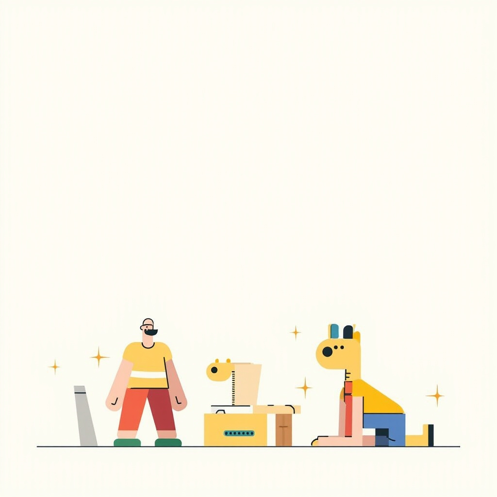

# 社交配图真实测试示例

使用仓库的 `createSocialImage` 入口真实调用 MiniMax `image-01`，每次请求固定只生成一张图片。文案是为这个示例编写的输入，不是本轮研究模型的输出。

本目录保存的是此前生成的 1:1 示例；当前代码请求已改为 `aspect_ratio: "3:4"`。本次参数调整使用模拟测试验证，没有重新调用付费 API。

> 天啊，AI 写代码越来越快，我们反而更需要想清楚要做什么。
>
> 把重复实现交给工具，把时间留给定义问题、核查结果和理解真实需求。
>
> 你最想让 AI 接手哪一部分，又想把哪一种判断留在自己手里？

- [原始社交文案](./social.txt)
- [完整文生图提示词](./prompt.txt)：明确包含“Corporate Memphis”“Alegria”、扁平化矢量艺术、极简几何图形。
- [调用记录](./result.json)：首次请求成功，1024×1024 JPEG，耗时约 29.4 秒。
- [完整实现](../../src/server/services/image.ts)、[供应商协议](../../src/server/providers/minimax.ts)、[提示词](../../src/server/prompts.ts)、[接口](../../src/app/api/social-image/route.ts)。

复现：在项目根目录运行 `npm run verify:image`。这会产生图片 API 用量，并更新本目录的结果文件。没有保存密钥或原始供应商响应。
