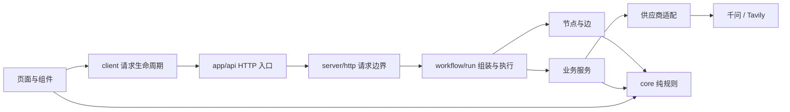
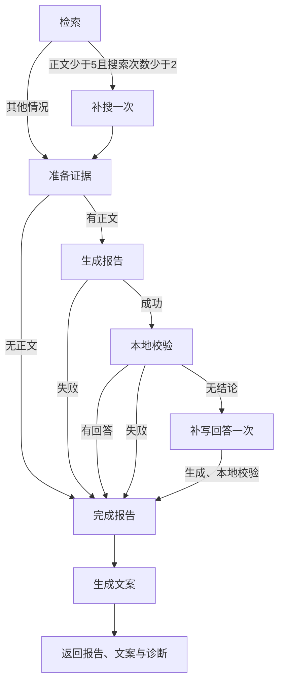

# 架构与演进约定

更新：2026-10-07。本文描述当前实现；历史开发计划和演示资料不定义当前行为。

## 设计目标

用最少的概念表达现有业务：取得文章、形成有依据的观察、生成文案。扩展通过稳定的能力接口进入，而不是让新功能穿透整个仓库。清晰度用可验证的边界、无循环依赖、失败分支和修改范围衡量。

当前系统属于代码控制的研究工作流：模型负责内容，程序负责预算、引用校验、路径和取消。它有节点与边，但不依赖特定 Agent SDK。长期任务的检查点、暂停恢复和分布式执行应由成熟运行时提供，在出现实际需求后接入；现有节点本身不是持久化执行器。

## 一张地图

```text
src/
  app/                      Next 页面与两个 HTTP 入口
  components/               报告、指标、依据、文案的展示组件
  client/                   浏览器请求生命周期与演示数据
  core/                     纯业务规则与对外数据契约
    contracts.ts            报告、来源、文案、请求的数据结构
    sources.ts              URL、来源类型、可用正文、覆盖、公开投影
    evidence.ts             证据编号、引用映射、事实与数值校验
    report.ts               观点归并、引用补齐、报告兜底
    social.ts               纯文案校验、长度、报告整理稿
  server/
    runtime.ts              统一错误、取消、模型 JSON 边界
    http.ts                 请求校验、体积限制、并发额度、错误响应
    prompts.ts              集中的模型指令与输入序列化
    providers/              千问与 Tavily 的 HTTP 协议适配
    services/               检索、报告、文案、签名快照
    workflow/
      state.ts              运行状态、节点契约、能力接口
      nodes.ts              独立节点函数，返回状态更新
      edges.ts              条件与转移，纯读取
      run.ts                服务组装、图执行、公开 analyze 入口
```



箭头表示允许的依赖方向。`core` 不读取环境、不联网、不依赖 React；浏览器不导入 `server`；供应商不引用业务服务；服务不引用工作流；节点和边通过 `state.ts` 中的能力契约调用服务。只有 `run.ts` 知道实际服务实现。`tests/architecture.test.ts` 检查这些边界和整个源码的循环依赖。

## 工作流



节点是具名函数，不代表必须有一个同名文件。当前八个节点集中在 `nodes.ts`，无逐节点包装文件。外部协议、较长的纯算法和服务仍按职责独立。节点返回局部更新，执行器统一合并；输入状态不原地改写。补搜服务使用研究副本，失败仍可保留本次副本取得的资料。

状态只保留跨步骤需要的原始研究、草稿、失败标志、警告和用量；可用来源、覆盖和最终响应在需要时计算。环境配置、取消信号、观察回调和服务对象放在执行上下文中，不作为业务状态存储。每次运行创建独立状态，服务接口可由测试替换。

报告生成或本地校验失败时清空未完成草稿，保留文章并明确说明回答未完成；无正文时说明检索情况，不虚构事实。不再填充通用观点或将指标说明充作回答。校验正常完成但回答被删空时进入 `recoverAnswer`：带原始问题、全部可用正文与校验原因，只生成一次文字回答，然后执行本地校验，保留此前通过的指标。补写失败不循环、不重新检索，也不覆盖已有指标。报告不再执行模型语义复核；正常成功路径仅调用一次报告生成和一次文案生成。

取消不进入兜底，HTTP 边界将原生取消映射为 499。首次模型格式修复和文案纠错由相应服务负责；补写模式禁止服务内部再次修复。当前图无回边，执行器检测重复节点，补写最多增加一次模型调用（生成回答）。

公开的 `analyze(idea, signal, observe, socialTargetLength)` 调用方式与 API 返回字段保持兼容，脚本使用新路径直接导入。复核相关观察事件随节点一起删除。请求体实际超限时统一返回 413；两个 API 分别保留单进程并发上限 2。

## 这轮收敛了什么

| 原结构 | 当前归属与处理 |
| --- | --- |
| `lib/analysis` 的 14 个文件 | `server/workflow` 的 4 个文件，保留节点与边，取消逐动作包装 |
| `analyze.ts` 转发入口 | 直接由 `workflow/run.ts` 导出，删除旧文件 |
| 来源类型、覆盖、状态各自模块 | 归入纯 `core/sources.ts` |
| 千问联网工具解析与正文块协议 | 当前生产无调用，删除实现与专用测试；来源状态用当前 Tavily 行为验证 |
| 无调用方的文章去重算法 | 删除，保留每篇独立提取文章的现行政策 |
| 证据映射和报告校验 | 归入纯 `core/evidence.ts`，文案可复用，不依赖生成服务 |
| 报告生成 | 归入 `services/report.ts`，相关模型输出处理集中 |
| 社交纯校验与联网生成混合 | 纯规则进 `core/social.ts`，联网和重试进 `services/social.ts` |
| 通用错误藏在千问客户端 | 移入 `server/runtime.ts`，Tavily 不再依赖千问模块 |
| 三处模型 JSON 清洗 | 共用 `parseModelJson`；各业务服务单独校验结构 |
| 两个 API 重复的并发、体积、JSON、错误处理 | 共用 `server/http.ts`；路由只声明输入与业务调用 |
| 页面内的计时、fetch、取消与卸载处理 | 移入 `client/use-analysis.ts`，增加过期响应检查 |

重构前 `src` 有 39 个 TypeScript/TSX 文件，当前 28 个，减少 11 个（约 28%）；旧 `src/lib` 的 31 个文件已删除并迁移必要职责。没有旧路径转发层，没有新增生产依赖。文件数仅作规模参考，关键结果是边界可测试、循环依赖为零、能力可以替换。

## 增长时改哪里

| 新需求 | 修改位置 |
| --- | --- |
| 改回答指令或写作风格 | `server/prompts.ts` 与提示词测试 |
| 新增模型或检索供应商 | `server/providers`、相应服务实现、`workflow/run.ts` 的组装 |
| 改覆盖、引用或数值政策 | `core` 与对应行为测试 |
| 新增研究步骤或路由条件 | `workflow/state.ts`、`nodes.ts`、`edges.ts` |
| 新增报告展示 | 数据契约与展示组件；纯格式规则留在 `core` |
| 流式进度 | 基于现有观察事件定义对外事件契约，并实现传输；避免公开上游全文事件 |
| 数据库存储与长任务恢复 | 新增实际需要的存储适配；选择具有检查点与恢复语义的运行时 |

短操作不再加一个转发文件。一个模块出现独立变化原因、独立副作用或明显不同的数据契约时才拆分。能力契约只描述实际需要的方法，不预建工具注册表、插件体系、仓储接口或通用 Agent 引擎。

签名快照为当前文案重生成保留了原提示词，这是现行产品规则；它不是通用会话记忆。接口内的并发计数仅适用于单进程，横向部署时需改为共享额度。节点返回更新使替换运行时更容易，但不意味着已经拥有检查点、幂等重放或暂停恢复。

## 验证

`npm test` 覆盖业务、工作流、取消、状态隔离、HTTP 并发释放、提示词边界、架构依赖和签名保护；`npm run typecheck`、`npm run build` 验证集成。两项 UI 脚本验证移动端布局、来源抽屉、请求重试、复制、重生成与旧结果清除。UI 测试使用模拟响应，真实 API 验证另行执行并会产生用量。

## 参考依据

- [Anthropic：Scaling Managed Agents，2026-04-08](https://www.anthropic.com/engineering/managed-agents)：围绕稳定接口分离可变化的执行机制。
- [Anthropic：Harness design for long-running application development，2026-03-24](https://www.anthropic.com/engineering/harness-design-long-running-apps)：逐项检验脚手架价值，并在模型能力变化后收敛结构。
- [LangGraph：Thinking in LangGraph，当前官方文档](https://docs.langchain.com/oss/javascript/langgraph/thinking-in-langgraph)：节点返回更新、保留原始状态、计算可推导数据。

这些原则提供设计依据；当前目录划分是结合本项目规模与行为作出的工程选择，并非官方规定或通用最优答案。
