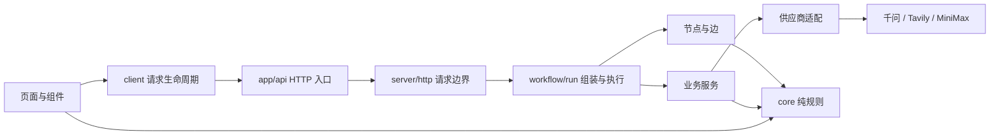
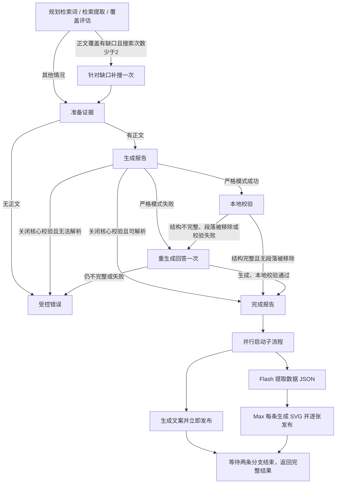

# 架构与演进约定

更新：2026-10-09。本文描述当前实现；历史开发计划和演示资料不定义当前行为。

当前 `main` 保留开场与社交文案流式展示，并合并自动数据海报；延续实验默认 `REPORT_CORE_VALIDATION=false`：公开 `analyze` 跳过核心内容校验与重生成。只有显式配置 `true` 才恢复严格模式。规则与图的独立调用仍默认严格，测试可显式传入 `validateCoreContent:false`。

社交写作始终只调用一次，当前服务不执行文案内容校验或自动纠错；只读取完整简报作为写作素材，后台解析模型段落文字。已删除复制简报作为成功文案的旧兜底。写作失败时报告仍保留、结果状态为 partial，并返回空的 failed 文案及签名重试入口，不触发配图。

## 设计目标

用最少的概念表达现有业务：取得文章、形成有依据的观察、生成文案。扩展通过稳定的能力接口进入，而不是让新功能穿透整个仓库。清晰度用可验证的边界、无循环依赖、失败分支和修改范围衡量。

当前系统属于代码控制的研究工作流：模型负责内容，程序负责预算、引用校验、路径和取消。它有节点与边，但不依赖特定 Agent SDK。长期任务的检查点、暂停恢复和分布式执行应由成熟运行时提供，在出现实际需求后接入；现有节点本身不是持久化执行器。

## 一张地图

```text
src/
  app/                      Next 页面与研究、文案、配图 HTTP 入口
  components/               报告、指标、依据、文案的展示组件
  client/                   浏览器请求生命周期与演示数据
  core/                     纯业务规则与对外数据契约
    contracts.ts            报告、来源、文案、请求的数据结构
    sources.ts              URL、来源类型、可用正文、覆盖、公开投影
    evidence.ts             证据编号、引用映射、事实与数值校验
    report.ts               观点归并、引用补齐、报告兜底
    social.ts               文案展示解码、长度与依据元数据、严格规则回归
  server/
    runtime.ts              统一错误、取消、模型 JSON 边界
    http.ts                 请求校验、体积限制、并发额度、错误响应
    prompts.ts              集中的模型指令与输入序列化
    providers/              千问与 Tavily 的 HTTP 协议适配
    services/               检索、报告、文案、签名快照
    workflow/
      state.ts              运行状态、节点契约、能力接口
      nodes.ts              独立节点函数，返回状态更新
      edges.ts              条件与转移，纯读取
      run.ts                服务组装、图执行、公开 analyze 入口
```



箭头表示允许的依赖方向。`core` 不读取环境、不联网、不依赖 React；浏览器不导入 `server`；供应商不引用业务服务；服务不引用工作流；节点和边通过 `state.ts` 中的能力契约调用服务。只有 `run.ts` 知道实际服务实现。`tests/architecture.test.ts` 检查这些边界和整个源码的循环依赖。

## 工作流



节点是具名函数，不代表必须有一个同名文件。当前九个节点集中在 `nodes.ts`，无逐节点包装文件。外部协议、较长的纯算法和服务仍按职责独立。节点返回局部更新，执行器统一合并；输入状态不原地改写。补搜服务使用研究副本，失败仍可保留本次副本取得的资料。

`social` 节点在完整报告确认后通过能力契约并行运行文案与数据海报，使用 `Promise.allSettled` 等待在途分支退出，再一次性返回独立结果与合计用量。文案结束即发 `social` 事件及同一签名重生成 token，海报状态通过 `data-posters` 事件发布快照。`run.ts` 是 `generateDataPosters` 的唯一服务组装点。服务只接收完成报告的 `summary[0].text`、取消信号、状态回调与可选提示词 1，不引用工作流。

并行文案分支继续发 `social-start` / `social-block`，结束时通过 `social` 确认最终文案，而不等海报完成。浏览器收到文案确认后保留尚未播完的逐字队列，失败则立即撤掉文案预览、显示文案错误。文案自身的等待状态与整个研究请求的等待状态分开，海报仍在生成时不会把已失败的文案继续显示为生成中。

`services/data-posters.ts` 先固定调用一次 `qwen3.8-flash`，经 JSON 解码及 `core/data-posters.ts:readDataObservations` 返回包含数字的去重文案数组，再以最多两个并发 worker 覆盖全部条目。每条固定调用一次 `qwen3.8-max`，集中提示词 2 保持用户原文，只填入该条文案。无条目数量上限、自动重试、纠错或失败兜底；提取失败是整个海报分支的明确错误，SVG / 单次模型失败只标记该条。两个分支共享请求取消，取消不标记为业务失败、不启动排队请求、不发布迟到状态。图片用量纳入主诊断，单独保留海报耗时。

`core/data-posters.ts:readStaticPosterSvg` 检查完整静态 SVG 的标签、属性、XML 闭合、固定画布和不透明背景，拒绝执行能力与远程资源。必要时只补入 SVG 图片命名空间，不重画或替换模型内容。`components/data-posters.tsx` 再检查展示边界，用 `img` 的 SVG data URL 隔离展示并提供 SVG 下载、原始代码、提取 JSON 与逐条错误。取消后保留已完成海报并显示中断；换问题通过既有请求身份清除旧状态。未调用图像生成供应商，也没有新增图片 API。固定提示词只是内容要求，程序不声称核验了视觉表达或数据含义。

状态只保留跨步骤需要的原始研究、草稿、失败标志、警告和用量；可用来源、覆盖和最终响应在需要时计算。环境配置、取消信号、观察回调和服务对象放在执行上下文中，不作为业务状态存储。每次运行创建独立状态，服务接口可由测试替换。

`run.ts` 将环境开关转换为 `validateCoreContent` 布尔策略传入状态；纯规则与节点不读取环境。关闭模式的 `generate` 边直接进入 `completeReport`，不运行 `validate` / `recoverAnswer`。服务只调用一次模型，使用纯展示解码器读取段落和指标；不执行长度、布局、引用完整性、数字锚点、指标字段完备性或旧套话过滤，不自动加入“未生成简短总结”的首答。缺失或未知证据只省略相应标签，正文保留；已知编号映射到真实来源 URL，不采用模型生成的链接。完整 JSON 解析、空正文错误、取消、断流与无文章正文错误仍保留；社交写作不进行内容校验，也不受报告开关影响。

下面的回答校验与重生成约定仅在严格模式启用；文章提取、来源保留、社交输入和传输规则在两种模式均适用。

`services/research.ts` 负责检索业务：先使用集中提示词改写查询，再调用 Tavily advanced（最多 15 个结果），对全部缺失正文的 URL 按每批 20 个执行 Extract。每次研究服务调用中，失败、缺失或不可用的正文再提取一次，成功的 URL 不重复请求；两轮提取的调用数和已知 credits 都计入诊断。首轮模型以提取正文评估问题覆盖，返回可选 `followUpQuery`；边只读取该字段与搜索预算选择下一步，补搜后不再评估或循环。篇数和来源类型不是补搜或回答门槛。规划失败使用原问题，评估失败结束研究并保留文章，检索失败保留已有用量和结果。提供公开 URL 时直接提取。研究用量和每轮 `searchSteps` 随状态返回；搜索摘要始终不能成为正文证据。页面的提取失败提示只指对应 URL 未取得正文，其他成功文章继续用于报告。

报告生成的 `summary` 各项包含纯文字、可选 `presentation/label` 与该段引用。严格模式本地校验也检查标题中的数字。完成阶段将有效段落保存在 `answerBlocks` 中供 `components/core-answer.tsx` 展示；未被段落使用的独立文章只补进归并的 `summary[0].references`。归并的 `summary[0].text` 是社交写作唯一正文输入，含完整回答而非仅短首答。`readSocialForDisplay` 只解码模型返回的文字，简报与全部文章依据在后台作为整体元数据保留（paragraphIndex=-1），不做逐段事实或数字验证、不要求 claimIds。页面的域名胶囊按每段去重，只链接已取得正文且真正被该段引用的来源；上方检索结果保留文章链接，不再另设研究来源列表。来源抽屉仅由指标卡和文案依据的引用按钮打开，并展示对应证据片段。

回答层次参考 Morphic 的“简短开篇 + 加粗要点标题与具体解释”，生成、规则和渲染各负其责：集中提示词要求首答为 1–2 句结论（通常 40–90 字），随后完整给出要点和结论；`core/report.ts` 检查唯一首答位于开头、无标题、无换行且不超过 120 字符，至少一个带标题的要点，以及末尾结论。仅有首答不合格。工作流检查引用校验是否移除了任意回答段落，即使首答和其他要点仍在也触发重生成；指标卡可独立移除，不影响回答完成判定。只有完整的最终回答才发出公开 `report` 事件。UI 使用独立 `strong` 加粗短首答，正文和引用保持普通字重，旧数据的超长第一项也不会被自动加粗。

报告生成请求失败、格式不完整、本地校验失败或移除回答段落时进入 `recoverAnswer`：带原始问题、全部可用正文与失败原因，只重生成一次文字回答，然后执行本地校验，保留此前通过的指标。工作流首次调用使用 `singleAttempt` 禁止服务内部格式修复，补写模式也只调用一次，因此报告总共最多两次模型请求。报告服务失败时通过受控错误附带已知模型调用和 token 用量，节点将其计入诊断。第二次仍失败或不完整时，`completeReport` 抛出 `INVALID_REPORT`，不发布部分报告、不生成对应文案；完全未取得正文时抛出 `NO_EVIDENCE`，不将检索情况或通用观点作为研究报告。独立调用报告服务默认保留最多一次格式修复，用于脚本和模拟验证。报告不执行模型语义复核；正常搜索路径调用一次检索词规划、一次检索覆盖评估、一次报告生成和一次文案生成。直接 URL 提取无需前两次调用。

取消不进入兜底或重试，HTTP 边界将原生取消映射为 499。严格模式报告失败重试由工作流统一控制；社交写作只调用一次，无自动纠错。当前图无回边，执行器检测重复节点，补写最多增加一次模型调用（生成回答）。

公开的 `analyze(idea, signal, observe, socialTargetLength, onEvent?)` 保留原有调用方式与 JSON 返回字段，新增可选公开事件回调，脚本使用新路径直接导入。复核相关观察事件随节点一起删除。请求体实际超限时统一返回 413；研究和文案 API 分别保留单进程并发上限 2。

`core/contracts.ts` 声明公开 `AnalysisEvent` 与阶段契约。流式入口在创建研究状态前调用独立的 `streamOpening` 服务：提示词只接收原始问题，独立 flash 模型关闭思考，使用 400 输出 token 预算，先接话再展开两个到三个具体关注点，通常 120–180 字。文字增量通过 `opening` 事件立即转发，由 `OpeningMessage` 和 `client/use-typewriter.ts` 累计逐字播放；上游完成后丢弃模型返回内容，再创建原状态、执行原节点和边，无需等待动画。开场输出不保存在工作流状态、不进入任何后续模型输入或签名快照，无重试或业务兜底，失败直接传播。JSON 调用没有展示开场。服务只在 `run.ts` 组装，供应商在原 `callQwen` 协议适配中支持 Responses SSE，忽略思考和工具事件。

报告独立使用 `QWEN_REPORT_MODEL`，默认 `qwen3.8-max`，沿用 7000 token 预算；其他模型配置不受此设置影响。报告服务通过可选 `onBlock` 能力回调启用上游流式，JSON 调用仍等待完整报告。原 `server/report-stream.ts` 已迁移到 `server/model-stream.ts`，由报告和文案共用字符串转义及嵌套边界解析；报告提取根 `summary` 数组中的完整对象，文案提取根 `paragraphs` 数组，支持字段顺序变化与任意网络分块；整个输出仍需完整 JSON 解析。默认关闭模式每段只解码展示字段、映射来源，并与正式报告共享纯文字整理规则。严格模式额外检查结构、首答位置与长度、要点标题、引用和数字，通过后才回调；遇到不合格段落停止发布后续段落并由工作流重生成一次，不叠加服务内部重试。

执行器在 `generate` 与 `recoverAnswer` 前分别发送编号 1 / 2 的 `report-start`、公开来源和 `coreValidation` 模式；关闭模式仅有第一轮。节点通过回调发布带轮次、顺序编号的 `report-block`。浏览器独立保存 `ReportPreview`，按顺序播放完整段落，段落播完才出现引用胶囊；减少动态效果时直接显示完整段落。关闭模式提示“正在生成正文”，不宣称校验通过。严格模式重生成清空旧轮次与播放队列，旧轮次的迟到段落被忽略。预览不进入 `analysis`、文案输入或签名快照。整篇失败或确认前取消、断流时清除预览；已确认报告不受后续文案失败影响。`report` 仍是整篇确认事件：若正文、样式和引用与预览相同，播完剩余队列再展示正式报告；如果不同，立即以正式报告为准。

执行器在节点运行前发送 `progress`，`completeReport` 合并后发送 `report`：使用与最终结果相同的公开投影，包含完整报告、公开来源与 `coreValidation`，暂不包含文案或重生成 token。最终报告与阶段报告使用同一生成时间，文案完成时不重复滚动页面。展示契约与签名快照不设正文/标签长度和回答布局门槛，签名与有效期校验保持不变。内部 `observe` 继续用于脚本诊断，其研究正文、模型原始 JSON 和纠错内容不进入公开流。

浏览器单独累计开场文字，切换问题或开始新请求时清除；使用既有请求身份和取消检查拦截旧增量。开场不代替核心观察，也不改变报告和文案状态。`opening.firstToken` 日志记录模型首段文字耗时，目标 2000ms；开场 token 单独记录，后续研究用量口径不变。总耗时包括开场。模拟测试验证即时转发和展示，真实供应商延迟仍需实测。协议依据：[Qwen Responses API](https://docs.qwencloud.com/api-reference/chat/openai-responses)。

`server/http.ts` 按 Accept 协商 JSON / SSE，两种传输共用端点并发额度。SSE 使用 POST fetch、JSON data 帧和 15 秒注释心跳；请求输入校验发生在返回流之前，流开始后的业务错误映射为受控 `error` 事件，各路由返回自己的完成事件（分析 `result`、重生成 `social-result`）。取消请求或消费端关闭流会中止执行信号，额度在执行真正结束后释放。`client/event-stream.ts` 共用跨块 UTF-8 解码及 SSE 分帧，`analysis-stream.ts / social-stream.ts` 分别检查业务事件顺序、错误与完整结束；`use-analysis.ts` 管理增量状态、超时和过期请求，页面先展示观察，再展示文案预览及完成内容。

报告确认后的 `social` 节点发送 `social-start`，通过 `state.ts` 中可选 `onBlock` 能力回调发布编号连续的 `social-block`；回调只承载文字，预览不进入工作流状态或签名快照。文案服务只请求一次，闭合的段落使用 `normalizeSocialText` 整理并跳过空段，最终仍完整解码模型 JSON，不新增事实或内容校验。独立重生成路由使用同一服务与原签名提示词，支持相同预览事件及 JSON 调用。

`SocialPreview` 与开场共用 `useTypewriter`，按与报告相同的 20ms 节奏逐字播放，长文本加速，遵循减少动态效果设置。最终内容与预览相同时等排队文字播完，不同时以正式结果为准。首次成功并播完后才开放复制与挂载配图；重生成期间保留已有版本和图片，全文确认且播完后才追加并选中新版本。失败、取消、断流清除未确认文案预览；开场播放在失败或取消时停止，切换问题时卸载。请求身份及取消信号阻止迟到文案恢复。

## 这轮收敛了什么

| 原结构 | 当前归属与处理 |
| --- | --- |
| `lib/analysis` 的 14 个文件 | `server/workflow` 的 4 个文件，保留节点与边，取消逐动作包装 |
| `analyze.ts` 转发入口 | 直接由 `workflow/run.ts` 导出，删除旧文件 |
| 来源类型、覆盖、状态各自模块 | 归入纯 `core/sources.ts` |
| 千问联网工具解析与正文块协议 | 当前生产无调用，删除实现与专用测试；来源状态用当前 Tavily 行为验证 |
| 无调用方的文章去重算法 | 删除，保留每篇独立提取文章的现行政策 |
| 证据映射和报告校验 | 归入纯 `core/evidence.ts`，文案可复用，不依赖生成服务 |
| 报告生成 | 归入 `services/report.ts`，相关模型输出处理集中 |
| 社交纯校验与联网生成混合 | 纯规则进 `core/social.ts`，联网和重试进 `services/social.ts` |
| 通用错误藏在千问客户端 | 移入 `server/runtime.ts`，Tavily 不再依赖千问模块 |
| 三处模型 JSON 清洗 | 共用 `parseModelJson`；各业务服务单独校验结构 |
| 两个 API 重复的并发、体积、JSON、错误处理 | 共用 `server/http.ts`；路由只声明输入与业务调用 |
| 页面内的计时、fetch、取消与卸载处理 | 移入 `client/use-analysis.ts`，增加过期响应检查 |

重构前 `src` 有 39 个 TypeScript/TSX 文件，架构收敛时为 28 个；本轮独立拆分核心回答组件后为 29 个；旧 `src/lib` 的 31 个文件已删除并迁移必要职责。没有旧路径转发层，没有新增生产依赖。文件数仅作规模参考，关键结果是边界可测试、循环依赖为零、能力可以替换。

## 增长时改哪里

| 新需求 | 修改位置 |
| --- | --- |
| 改回答指令或写作风格 | `server/prompts.ts` 与提示词测试 |
| 新增模型或检索供应商 | `server/providers`、相应服务实现、`workflow/run.ts` 的组装 |
| 改覆盖、引用或数值政策 | `core` 与对应行为测试 |
| 新增研究步骤或路由条件 | `workflow/state.ts`、`nodes.ts`、`edges.ts` |
| 新增报告展示 | 数据契约与展示组件；纯格式规则留在 `core` |
| 流式进度 | 修改 `core` 的公开事件契约、工作流执行器和 HTTP / client 传输；避免公开上游全文事件 |
| 数据库存储与长任务恢复 | 新增实际需要的存储适配；选择具有检查点与恢复语义的运行时 |

短操作不再加一个转发文件。一个模块出现独立变化原因、独立副作用或明显不同的数据契约时才拆分。能力契约只描述实际需要的方法，不预建工具注册表、插件体系、仓储接口或通用 Agent 引擎。

## 社交配图

文案与配图的成功版本分别由 `components/social-content.tsx` 和 `components/social-image.tsx` 保存在浏览器组件状态中；新版本追加后自动选中，失败不添加版本，也不清除已有内容。`components/version-carousel.tsx` 负责共享的左右按钮、方向键和触摸滑动切换，只管理选择交互，不发请求。文案的文字、长度、警告和依据随选择同步，复制与手动复制使用当前版本；配图的图片、下载格式和提示词随选择同步。切换文案不自动生成图片，手动配图使用当前选中的文案；生成期间仍可查看历史版本。切换问题会卸载组件并清除本页历史，迟到响应不能恢复旧内容，无服务器存储或 API 契约变更。

配图由浏览器在首次可用社交文案完成后自动触发：`components/social-image.tsx` → `/api/social-image` → `workflow/run.ts:createSocialImage` → `services/image.ts` → `providers/minimax.ts`。组件挂载后用首次文案自动请求，下方显示等待转圈，成功或失败后停止；手动按钮按当前选中的文案重新生成和失败重试。首次请求延迟到 effect 设置完成后，避免 React Strict Mode 的丢弃挂载重复请求；卸载时清除计时器并取消请求。演示和首次未完成的文案不挂载配图组件。服务实现在现有 `run.ts` 组装，入口在调用前后检查取消；不向研究图添加条件分支或图像失败兜底。`core/contracts.ts` 保存纯输入契约与图片返回类型，浏览器只导入这些契约。

`prompts.ts:socialImagePrompt` 接收当前文案全文，固定 Corporate Memphis / Alegria、扁平矢量和极简几何风格；不把文章正文、依据或密钥传入图片模型。`services/image.ts` 管理提示词长度与最多两次请求的预算，重试原封不动重发同一个提示词，耗尽后抛出错误；取消、配置、鉴权与余额错误直接退出。没有替代图片、替代模型、缓存回退或自动改写文案。

供应商适配仅负责环境配置和 MiniMax HTTP 协议：固定 `image-01`、`n=1`、`aspect_ratio=3:4`、base64 和关闭 prompt optimizer，检查 HTTP 及 `base_resp.status_code`，确认响应恰好一张图片并识别 PNG / JPEG / WebP；不暴露上游原始错误。页面首次取得可用文案时挂载配图组件，此后重写文案保持组件挂载，保留图片和进行中的配图请求；文字 props 更新不触发自动请求，点击“重新生成配图”才使用当前选中的可用文案。文案重写中或重写后无可用文案时禁用配图按钮。切换问题会卸载组件、取消请求并清除旧图。base64 在页面展示并通过下载链接保存，服务器不新增图片存储系统。

签名快照为当前文案重生成保留了原提示词，这是现行产品规则；它不是通用会话记忆。接口内的并发计数仅适用于单进程，横向部署时需改为共享额度。节点返回更新使替换运行时更容易，但不意味着已经拥有检查点、幂等重放或暂停恢复。

## 验证

`npm test` 覆盖业务、工作流、取消、状态隔离、HTTP 并发释放、提示词边界、架构依赖和签名保护，以及图片协议、次数预算、输入限制、取消和无兜底行为；流式测试覆盖报告先于文案、公开投影、SSE 分块、错误、截断、取消及与 JSON 共用额度。`npm run typecheck`、`npm run build` 验证集成。五项 UI 脚本验证移动端布局、来源抽屉、请求重试、复制、重生成与旧结果清除、分段回答的域名胶囊直达原文，以及文案和配图历史版本、左右切换、所选版本的复制与下载、生成失败保留和过期请求。`npm run test:ui:stream` 通过本地模拟 HTTP 服务逐块返回，验证真实浏览器接收进度、先展示观察、后展示文案，以及失败和取消的状态。UI 测试使用模拟响应，`npm run verify:image` 真实调用同一配图入口并保存示例，会产生用量。

## 参考依据

- [Anthropic：Scaling Managed Agents，2026-04-08](https://www.anthropic.com/engineering/managed-agents)：围绕稳定接口分离可变化的执行机制。
- [Anthropic：Harness design for long-running application development，2026-03-24](https://www.anthropic.com/engineering/harness-design-long-running-apps)：逐项检验脚手架价值，并在模型能力变化后收敛结构。
- [LangGraph：Thinking in LangGraph，当前官方文档](https://docs.langchain.com/oss/javascript/langgraph/thinking-in-langgraph)：节点返回更新、保留原始状态、计算可推导数据。

这些原则提供设计依据；当前目录划分是结合本项目规模与行为作出的工程选择，并非官方规定或通用最优答案。
