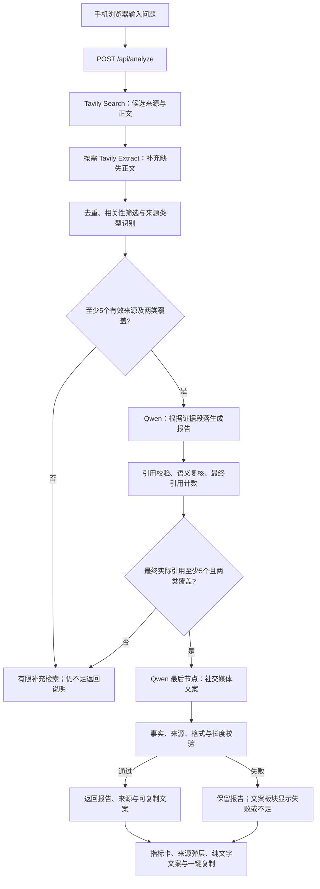

# Insight-to-Post：MVP 开发计划

更新时间：2026-10-06  
状态：v0.2 开发与真实浏览器验收已完成；真手机人工验收待用户确认。Tavily 搜索及正文提取、至少 5 个最终引用的门槛、社交文案最后节点、独立文案板块和一键复制均已实现。已从 `key.txt` 配置并验证 Tavily 鉴权。当前服务端口为 3001，v0.1 千问内置搜索验收保留为历史；各项最新验证状态见验收记录。  
题面参考：[候选人任务说明](./Insight-to-Post_候选人题面_可发送版.html)

## 1. 产品目标

做一个手机浏览器可访问的工具：用户输入一句话问题，系统联网查找资料，输出一份有真实来源、可查看证据的指标卡报告，再生成可复制到 X 的纯文字社交媒体文案。

第一版优先跑通“问题 → 联网资料 → 结构化分析 → 引用校验 → 社交文案生成与校验 → 手机展示与复制”的完整链路。分析报告帮助用户读懂问题，新增的独立文案板块帮助用户表达和分享。遇到证据不足时明确说明，不为填满模板而生成没有依据的数据。

新的研究链路使用 Tavily Search API。**每次正式分析回复至少实际参考并引用 5 个相关、去重、有可用正文的信源**，同时保留至少两类信源的要求。搜索返回 5 个链接、提示词要求参考 5 个来源、或向模型提供 5 份资料，均不能代替最终引用计数。来源不足时返回研究不足说明，不编造或引用无关材料凑数。

当前版本是主动收敛后的 MVP，不等于已经满足原题全部 Must 要求。

## 2. 已确定的范围

### 2.1 第一版实现

| 功能 | 行为 |
| --- | --- |
| 问题输入 | 多行输入框、示例问题、提交按钮 |
| 联网研究 | 后端调用 Tavily Search API，取得候选来源和正文；每次正式回复至少实际引用 5 个有效信源，覆盖至少两类 |
| 分析总结 | 输出简短总结，区分资料支持的事实与分析推断 |
| 指标卡模板 | 只做一种模板，每份报告最多 3～5 张卡，允许少于 3 张或没有卡片 |
| 引用查看 | 点击卡片引用，查看来源标题、URL、可用日期和证据片段 |
| 原文跳转 | 来源面板提供打开原文入口 |
| 分析局限 | 说明来源不足、时间范围不足、统计口径差异等实际问题 |
| 社交媒体文案 | 在分析报告通过校验后，以独立最后节点生成中文 X 文案：吸引兴趣的开头、短段落正文、引起共鸣与讨论的结尾 |
| 一键复制 | 新增独立输出板块，复制完整纯文字文案；段落之间保留一个空行，复制成功与失败均有反馈 |
| 状态与错误 | 通用加载提示、失败提示、重试；保留输入内容 |
| 手机适配 | 单列布局、易点击的引用入口、底部来源弹层 |
| 可复现交付 | README、环境变量示例、启动脚本、设计决策说明 |

### 2.2 本阶段暂缓

- X 与小红书发布，包括平台鉴权、发布预览、删除、幂等。
- 首字延迟小于 2 秒、逐字流式响应、实时分阶段进度。
- 生图模型、封面插画。
- 图片导出、PNG 预览与保存。
- 横向对比表和时间线模板。
- 用户登录、数据库、云端历史记录。
- PWA 安装、离线使用能力。
- 复杂 Agent 框架、任务队列和微服务。Tavily 独立搜索 API 已纳入本次范围。

第一版在网页中展示分析报告与可复制文案，由用户复制后自行发布到 X。两者保存在当前页面状态中，刷新后不保证恢复。

### 2.3 与原题的差异

| 原题要求 | MVP 处理 |
| --- | --- |
| M1：对话输入、流式响应、首字延迟 | 保留问题输入与通用加载提示；流式和首字指标暂缓 |
| M2：真实检索、至少两类信源、结论可回溯 | 使用 Tavily，新增每次正式回复至少 5 个有效且实际引用的信源；覆盖不足不输出达标报告 |
| M3：至少三种呈现模板 | 先完成指标卡一种模板，其他两种暂缓 |
| M4：真实发布到 X | 增加 X 文案生成和一键复制；平台直接发布仍暂缓，复制不算完成真实发布验收 |
| M5：手机端完整可用 | 保留 |
| M6：README 与启动脚本 | 保留 |

以上差异必须在最终设计决策说明中写清楚，不能把 MVP 描述为完整通过原题验收。

## 3. 技术架构

采用一个 Next.js 项目同时承载页面和后端接口。

| 部分 | 技术选择 | 职责 |
| --- | --- | --- |
| 页面 | Next.js App Router、React、TypeScript | 输入、报告、来源弹层、社交文案与复制反馈 |
| 样式 | Tailwind CSS | 手机布局、卡片排版、交互状态 |
| 后端 | Next.js Route Handlers，Node.js runtime | 直接调用 Tavily、整理证据、调用千问生成并复核报告 |
| 模型 | `qwen3.8-flash` | 根据证据生成并复核报告，再将已核验内容改写为社交文案，不负责搜索 |
| 模型调用协议 | 千问 OpenAI 兼容 Responses API | 不挂载 `web_search` / `web_extractor`，保留结构化生成及校验 |
| 搜索服务 | Tavily Search API | 后端确定性调用，获取候选 URL 和返回内容 |
| 网页内容 | Tavily Search 的 `raw_content`，必要时 Tavily Extract | 搜索同时请求正文；缺失或不足时按 URL 补充提取 |
| 输出校验 | Zod、自定义规则 | 校验字段、来源关联、数字与证据 |
| 持久化 | 本阶段不接数据库 | 当前报告保存在页面状态中 |

依赖采用开发时确认可用的稳定版本并提交锁文件。上线运行环境需要支持 Node.js 后端，不能只部署静态页面。



所有模型调用和 API Key 都位于后端。前端只请求自己的 `/api/analyze` 与 `/api/social-content`。

## 4. Tavily 搜索与千问生成方案

### 4.1 配置

```dotenv
QWEN_API_KEY=填写自己的密钥
QWEN_BASE_URL=https://maas.qianwenaiapi.com/compatible-mode/v1
QWEN_MODEL=qwen3.8-flash
TAVILY_API_KEY=填写自己的Tavily密钥
TAVILY_BASE_URL=https://api.tavily.com
```

真实配置放在不提交版本库的 `.env.local` 中，仓库只提交 `.env.example`。密钥不使用 `NEXT_PUBLIC_` 前缀，不返回给前端，不写入日志。

配置与 `.env.example` 已接入 Tavily。启动脚本调用 `scripts/configure.mjs`，按服务标签或可识别的密钥前缀分别导入 `TAVILY_API_KEY` 和 `QWEN_API_KEY`，不将两者互换，不覆盖已有有效配置；同一服务多个候选时要求明确归属。导入、错误提示和验收均不输出密钥正文；`key.txt` 保持忽略且不随交付打包。当前工作区已完成导入与 Tavily 官方接口 HTTP 200 鉴权验证。

页面提供叙述长文与标准短帖选项，分别传入 2000 或 280 的 X 加权字符目标；长文默认选中并提示需账号支持长帖。未传入请求目标时使用 `.env.local` 的 `X_TARGET_LENGTH`（默认 280）。计数使用 `twitter-text`，不以 JavaScript 字符串长度替代 X 加权长度。

### 4.2 Tavily 请求与正文边界

搜索由后端直接请求 `POST https://api.tavily.com/search`，使用 Bearer 密钥。初始候选请求按以下参数设计，数量和超时预算在接入实测后确认：

```json
{
  "query": "用户问题对应的检索词",
  "search_depth": "advanced",
  "max_results": 10,
  "include_raw_content": "markdown",
  "include_answer": false,
  "auto_parameters": false
}
```

`max_results` 是候选上限，不保证返回数量、更不保证 5 个有效信源。搜索结果的 `url`、`title`、`content`、`raw_content` 等字段按实际返回解析。`raw_content` 可能为空；短搜索片段只用于筛选，不能自动当作已取得完整原文。Tavily 生成的 `answer` 不作为引用证据。

优先使用 `raw_content` 建立可定位的原文段落；没有正文的相关结果可通过 Tavily Extract 补充提取。记录每个 URL 的请求和成功/失败结果，而不是只记录总请求次数。请求原始正文也算尝试提取；不能将搜索已请求正文、但正文为空的来源标为“未尝试提取”。

可用来源不足 5 个或类型覆盖不足时，最多增加一轮针对缺口的补充检索。对相关候选优先取 8–10 个以预留失效与校验淘汰空间；不要求把所有搜索命中都传给模型。仍不足时停止并说明，不无限检索、不悄悄回退千问内置搜索。

官方参考（2026-10-06 核对）：[Tavily Search](https://docs.tavily.com/documentation/api-reference/endpoint/search)、[Tavily Extract](https://docs.tavily.com/documentation/api-reference/endpoint/extract)、[X 字符计数](https://docs.x.com/fundamentals/counting-characters)。当前已完成真实 Search 和按需 Extract；每次实际成功率、耗时与返回用量单独记录，不承诺固定响应速度。

### 4.3 后端研究与模型生成

1. 后端调用 Tavily，优先论文、官方统计和机构报告，新闻补充背景；记录真实响应、来源元数据与提取结果。
2. 去重与相关性筛选，确认至少 5 个来源有可用正文，并覆盖至少两类；未达到则执行一次有边界的补充检索。
3. 分配 `S1` 等来源 ID 与 `S1-E1` 等证据段落 ID。千问只从这些证据中生成总结、指标卡和局限，不挂载搜索工具、不添加 URL。
4. 模型必须在整份回复中实际引用至少 5 个不同的有效来源。5 个来源不等于 5 张卡，每张卡仍可引用一个或多个来源。
5. 保留 Zod、引用映射、数字/单位/时间检查和一轮模型辅助语义复核；模型格式异常仅允许一次修正。
6. 对最终保留的总结与卡片重新计数引用。如果删除结论后少于 5 个来源，或最终引用没有两类覆盖，不将预校验来源数量当作达标；最多一次引用修正，再失败返回证据不足说明。
7. 只有正式报告通过以上门槛，才进入独立的社交媒体内容节点。该节点以最终报告、已采用证据与必要局限为输入，生成文案及逐段依据映射；不重新搜索，不使用已经被复核删除的结论。
8. 校验社交文案事实、数字、时间、样本范围、推断措辞、实际使用的来源、纯文字格式和目标长度。最多一次修正；仍失败只标记文案不可用，保留已通过的分析报告。

在选取模型上下文时必须保留至少 5 个可用来源的支持段落；字符预算不能静默挤掉第五个来源。不得为了满足计数插入无关事实、装饰性引用或无内容链接。

当前实现选取最多 8 个去重候选，优先保留不同已识别类型。每个来源独立分配证据预算，依据问题词、量化信息与局限措辞选取段落，最多约 7000 字符；原文段落 ID 保持可映射，减少导航等无关内容对模型的干扰。该筛选是启发式辅助，最终相关性与事实支持仍需复核。

### 4.4 最后节点：社交媒体内容输出

**用途与风格。** 报告负责解释，文案负责让读者愿意读完并讨论。参考用户提供的“AI 参与下一代 AI 研发”文案的叙述结构：惊讶或反差开场 → 读者熟悉的背景 → 一句核心变化 → 有依据的具体过程 → 人的角色或生活影响 → 共鸣与讨论。学习结构与语气，不复制固定句子，不把示例中的 NaiveAI、AI4AI 或“这两天”等表述自动当成当次研究事实。

- 开头 1～2 句直接提出有证据支持、值得关注的变化，可用真实反差或问题吸引兴趣，避免夸大、制造恐慌、把探索说成已普遍实现。“天啊”等感叹并非每篇必用。
- 正文用自然中文、短句与短段落展开，说明“发生了什么、具体怎么发生、为什么与你有关”。可用一段独立短句强调转折；概念首次出现时用通俗解释。保留必要的年份、样本、条件与不确定性。
- 结尾从事实落到工作、选择或人的角色等具体处境，引起共鸣与讨论。按用户最新要求，表达形式交给模型，可用提问、感悟、留白或陈述，不强制问句或问号，不自动改写结尾标点。这是写作建议，不作为拒绝文案的硬性条件；事实、来源、格式与长度仍须校验。
- 默认生成一份完整文案，不自动拆成串帖、不添加封面或平台发布动作。文案为纯文字，不包含 Markdown 标题、加粗标记、列表符号、代码围栏、HTML、来源 ID 占位符或“以下是文案”等模型说明。默认不附表情、话题标签或推广文案。
- 统一换行为 `\n`，去除段首尾多余空白，以 `\n\n` 分隔段落；保留一个空行，不输出制表符、零宽字符或连续多余空行。复制内容只包含文案正文。
- 文案必须基于至少 5 个最终有效来源并保留两类覆盖；逐事实段记录所用报告结论和证据 ID，校验后单独计算实际支持来源，不能把报告的 5 来源计数直接继承给文案。仅相关链接列表不能代替实际使用。依据展示在文案板块的“查看文案依据”中，不将内部 ID 或界面标签混进复制正文。
- 文案的推断或提问不能暗含未经支持的新事实，不能将相关性改写成因果，不能丢掉使结论成立的关键限制。文案引用不足时最多修正一次，仍不足显示“文案证据不足”，不启用复制。
- 显示文案长度，按实施时核对的 X 目标长度规则与账号能力设置上限；超过目标长度时先压缩，仍超限明确提示，不标记为可直接发布。若缩短会破坏证据或关键信息，保留分析报告并显示文案不可用，不强行截断。

参考结构示意（只示意表达，不作为事实模板）：

```text
一个有依据的变化，可能比我们想象中更早发生。

当很多人还在讨论熟悉的问题时，新的变化已经出现在某个具体场景里。

用短段落解释证据支持的过程、范围和限制。

这也把一个更贴近我们的选择推到了眼前。

当这种变化进入你的工作，你最想保留哪部分判断和责任？
```

## 5. 证据与引用规则

### 5.1 来源记录

后端保存本次请求所需的来源记录，随报告返回必要字段：

```text
id：项目分配的来源 ID
url：工具实际返回的来源链接
title：可取得的文章标题，缺失则留空
sourceType：研究论文 / 官方统计 / 机构报告 / 新闻 / 其他 / 未知
publishedAt：可确认的发布日期，缺失则留空
provider：tavily
extractedContent：Tavily 实际返回并通过可用性检查的正文
contentOrigin：search_raw_content / extract_raw_content
extractionStatus / extractionReason：按 URL 记录尝试、失败、不可用或可用及原因
status：未尝试提取 / 提取失败 / 内容不可用 / 内容已引用 / 已提取未引用
```

前端不需要获得全部长正文，只返回引用所需的证据片段和来源元数据。

### 5.2 硬性检查

- 每张卡引用的来源 ID 必须存在于本次来源记录中。
- URL 从后端记录映射，拒绝模型新增的来源链接。
- 证据片段需要能在本次取得的提取内容中定位；允许空白字符等格式归一化，不允许把模型摘要伪装成原文。
- 检查数字、单位、日期和统计范围的对应关系；复杂语义仍需要模型辅助复核或人工检查。
- 不把局部样本描述成全行业结论，不把相关性改写成因果关系。
- 推断需要标明，不能混入数据事实。
- 只有来源链接、没有可用内容时，不能据此生成声称已核验的量化卡片。
- **每次正式回复最终有效引用的来源数至少为 5**。按规范化 URL 去重，同一原文的镜像或重复转载合并；同一来源多个证据段落仍只算 1 个。
- 计数对象是通过全部校验与复核、在最终卡片或总结中实际引用的来源。仅搜索返回、仅送入模型、仅列在“全部来源”中、不相关或失效的来源均不计入。
- 最终实际引用的来源仍需至少两类；5 个来源不等于 5 类，同一研究的多种呈现不等于独立复现。

### 5.3 不足与降级

| 情况 | 处理 |
| --- | --- |
| 没有成功的 Tavily 搜索记录 | 返回研究失败或有限重试，不使用模型常识冒充检索结果 |
| 可用正文或最终有效引用少于 5 个来源 | 最多一次补充检索及一次引用修正，仍不足返回 `insufficient`；不输出正式结论报告，不伪装为已满足 5 信源 |
| 正文提取失败 | 使用其他有证据的来源；无法支持的卡片不展示 |
| 只有一类可确认来源 | 标记来源覆盖不足；补充后仍不足不输出达标报告 |
| 没有量化证据但有至少 5 个有效引用及两类覆盖 | 可返回有据的文字说明并提示无指标卡，不强行填卡 |
| 某张卡引用无效 | 丢弃该卡或进行一次有边界的修正 |
| 模型输出格式错误 | 有限修正，仍失败则返回明确错误 |
| 检索或模型超时 | 返回超时提示并允许重试 |

链接与片段校验只能保证可追溯性的一部分，不能完全证明结论正确。来源面板始终提供人工核验入口。

## 6. 手机端展示

### 6.1 输入状态

- 页面顶部展示简短产品说明。
- 一个多行问题输入框，下面放 2～3 个示例问题。
- “开始分析”作为主要按钮。
- 请求进行中禁用重复提交，保留用户问题，显示通用加载提示。
- 失败后保留问题，显示可理解的错误原因和重试入口。

### 6.2 报告状态

按以下顺序单列展示：

1. 问题标题、报告生成时间。
2. 一句话总结。
3. 最多 3～5 张指标卡。
4. 分析局限与来源覆盖提示。
5. 全部来源。
6. 独立“社交媒体文案 · 适合 X”板块：文案预览、长度、文案依据、状态与“一键复制”。

报告显示“实际引用 x / 至少 5 个信源”与来源类型覆盖；实际引用数量必须来自后端最终校验结果。证据不足状态显示“本轮仅取得 x 个有效来源，尚缺 y 个”，不展示达标标识。错误、取消和检索不足说明是状态消息，不冒充满足门槛的正式分析回复。

指标卡结构：

```text
指标名称
核心数字 + 单位
含义与解释
数据时间 / 统计范围
查看依据 [1]
```

一张卡突出一个主要指标。窄屏不挤成多列；引用入口留出足够点击空间。

### 6.3 来源弹层

点击引用从底部打开面板，展示标题、来源类型、可用发布日期、证据片段和“打开原文”。支持关闭后回到原阅读位置。

缺失日期显示“日期未知”；报告生成时间与资料发布日期分别呈现。

来源列表与弹层保留四类主标签及“已提取未引用”。“内容已引用”仅代表被最终结论实际使用；计数口径与正式报告的 5 来源门槛一致。

### 6.4 社交文案板块与复制交互

预览采用保留换行的纯文字排版，段落之间有空行，手机上正常换行。标题、长度、依据入口、状态和复制按钮属于界面，不写入复制文本。点击“一键复制”写入与预览一致的完整正文，只有剪贴板写入成功才显示“已复制”；失败显示原因并提供可全选的文字区域，供用户手动复制。手机局域网 HTTP 环境也需验证手动复制路径。

文案生成中显示等待状态；失败或证据不足时保留报告与来源，显示文案单独的原因和重试入口，重试复用已核验报告，不重复搜索。文案不可用时禁用复制。请求取消或输入新问题后，避免显示或复制上一份报告的文案。用户自行粘贴到 X 并检查发布预览，系统不登录或代发。

## 7. 后端接口与代码组织

主分析接口负责完整链路，另提供只重试文案的接口：

```text
POST /api/analyze
输入：{ idea: string, socialTargetLength?: 280 | 2000 }
输出：报告、已使用的来源、局限、社交文案和各节点状态
```

响应包括：

```text
status：complete / partial / insufficient
report：标题、总结、生成时间、cards、limitations；事实总结与卡片结论分配稳定 claimId，供文案依据关联
cards[]：claimId、指标、数值、单位、时间、范围、解释、references
references[]：sourceId、证据片段
sources[]：来源 ID、URL、标题、类型、日期
warnings[]：来源覆盖不足或提取失败等提示
coverage：requiredSources=5、eligibleSourceCount、citedSourceCount、citedSourceTypes、requirementMet
socialContent：status=ready / failed / insufficient / skipped；text、characterCount、targetLength、warnings
socialContent.claimReferences[]：paragraphIndex、reportClaimIds、sourceId、evidenceIds（供依据展示，不进入复制文字）
socialContent.coverage：requiredSources=5、citedSourceCount、citedSourceTypes、requirementMet
diagnostics：Tavily 搜索/补充提取次数、返回的用量、Qwen 各节点调用/token 数、社交节点耗时、总耗时
```

校验或外部服务完全失败时，使用统一错误格式和适当 HTTP 状态码；业务证据不足通过 `insufficient` 返回，不伪装成成功分析。

`complete` 必须满足最终引用至少 5 个、至少两类、结论通过校验；`partial` 也不能绕过 5 信源门槛，只用于已达到来源门槛但缺少量化指标或部分结论被移除等局限。`insufficient` 不输出正式事实总结或指标卡，仅返回缺口说明与供人工查看的来源，实际不足的数量如实记录。该字段约定已实现。

顶层 `status` 表示分析报告质量，`socialContent.status` 表示文案可用性，两者独立展示；报告达标而文案失败时保留报告，不能把失败变成整轮研究失败，也不能标记全部节点完成。分析不足时 `socialContent.status=skipped`、`text` 为空，不生成待发布内容。文案生成后仍需通过 Zod 与事实/来源检查；复制使用校验后的 `text` 字段。

文案重试使用 `POST /api/social-content`，请求 `{ token: socialRetryToken }`。后端返回的签名凭据包含已核验报告、已引用原文片段与目标长度，两小时有效；服务端校验签名、时限及报告来源门槛后只运行文案节点。不能由客户端任意修改报告或依据，不触发重复检索；不需要数据库。凭据不包含 API 密钥，也不随公开示例报告交付。

建议目录：

```text
src/
  app/
    page.tsx
    api/analyze/route.ts
    api/social-content/route.ts
  components/
    idea-input.tsx
    report-view.tsx
    metric-card.tsx
    source-sheet.tsx
    social-content.tsx
  lib/
    tavily-client.ts
    qwen-client.ts
    research.ts
    evidence.ts
    generate-report.ts
    validate-report.ts
    generate-social-content.ts
    validate-social-content.ts
    source-status.ts
    source-coverage.ts
    schemas.ts
    prompts.ts
tests/
.env.example
README.md
start.ps1
```

前端负责报告、来源、纯文字文案展示和复制交互；Tavily 请求及逐 URL 响应解析、模型请求、证据和引用计数检查、社交文案生成与校验位于后端模块，Route Handler 负责协调流程。

## 8. 开发步骤

### 阶段 0：验证 Tavily 与配置

- 从用户已提供的 `key.txt` 按服务归属导入 Tavily Key，保留千问 Key 用于生成；验证缺失、归属不明和已有配置保护，不打印密钥。
- 用真实问题调用 Tavily Search，并验证必要的 Extract 补充提取。
- 检查候选 URL、`raw_content`、空正文、失败列表、错误、用量与超时。
- 确认可以把提取内容与具体 URL 关联。
- 记录检索与提取用量、实际耗时、模型 token，不预设固定响应速度。

通过条件：至少一个真实案例取得 5 个去重有效来源及两类覆盖，并能在最终回复中实际引用、生成并校验报告。

若 Tavily 正文能力或额度不足，明确缺口并保持不足状态；不把模型链接或 Tavily 合成答案当作证据。

### 阶段 1：调整现有手机界面

- 复用现有 Next.js、TypeScript、Tailwind CSS 和校验模块。
- 添加最终引用数量与最低门槛提示，调整不足状态、来源列表和弹层原因。
- 新增文案板块、保留空行的纯文字预览、长度与依据入口、复制成功/失败反馈及手动复制路径。
- 使用明确标记的示例数据打磨指标卡模板；示例模式不冒充真实联网结果。

### 阶段 2：接入真实分析链路

- 将千问研究工具链替换为 Tavily 后端搜索/正文链；保留模型生成与复核。
- 完成 Tavily 响应解析、来源去重、原文段落编号及逐 URL 状态。
- 完成生成前与复核后两次来源门槛检查、有限补充检索及引用修正，防止校验淘汰后引用少于 5。
- 接通 `/api/analyze`，使用真实检索结果替换示例数据。
- 接入独立最后节点，按参考文案的叙述结构生成社交内容，校验与报告一致性、文案实际来源覆盖和纯文字格式；文案失败不丢失报告。
- 接入只重试文案的接口，复用并重新检查当前已核验报告，不重复搜索；控制文案修正次数。

### 阶段 3：稳定性与手机体验

- 完成输入限制、重复提交控制、外部调用超时和有限重试。
- 记录必要诊断信息，避免记录密钥或无必要的用户内容。
- 在真实手机上检查输入、滚动、来源弹层、原文跳转和错误重试。
- 检查文案预览与粘贴内容一致，尤其段落空行、手机复制失败回退及换问题后的文案关联。

### 阶段 4：交付

- 更新 README、`.env.example` 与 Windows 启动脚本，分别检查 Tavily 和千问配置。
- 支持手机与电脑同 Wi-Fi 时，通过电脑局域网地址访问开发服务。
- 使用 Node.js 环境托管，或按题面允许的方式提供不超过 3 分钟的手机视角录屏。
- 完成设计决策说明，说明信源、引用检查、平台发布暂缓和功能取舍。

## 9. 验收与测试

### 核心验收

- 输入一个真实问题，能够取得真实检索资料并展示报告。
- 每份正式回复至少实际引用 5 个去重、有可用正文、与问题相关的信源；计数由后端对最终报告重算。
- 每张有效指标卡都关联本次来源与可定位证据。
- 来源链接可以从手机打开，数字和统计范围可以人工对照。
- 使用至少一个案例验证“最终实际引用至少 5 个且至少两类覆盖”；旧版两来源报告不能用作本次达标证明。
- 没有量化证据时，不生成编造的数字卡片。
- 失败、超时和重试不丢失用户输入，不出现白屏。
- 手机窄屏不出现正文横向溢出，来源弹层可正常关闭。
- 最后节点生成独立中文社交文案：开头有依据地吸引兴趣，正文短段落自然展开，结尾关联读者处境、引起共鸣与讨论；不因结尾不是问句或没有问号而拒绝。
- 文案本身经事实复核，实际支持来源至少 5 个且两类覆盖；不新增事实、不误用参考文案中的专有名词和相对日期。
- 一键复制得到纯文字，段间一个空行，无 Markdown/内部引用 ID/界面提示；粘贴后与预览一致，复制失败不误报成功。
- 文案长度按目标 X 配置检查，超限不标记可直接发布；文案失败可单独重试，报告仍可阅读。
- 新使用者配置自己的 Key 后，按 README 可以启动。

### 必要测试

- 无效来源 ID 被拒绝。
- 工具提取为空时，不生成已核验卡片。
- 证据片段与资料不匹配时，被拦截或降级。
- Tavily `raw_content` 为空、访问拒绝、Extract 部分失败、限流与鉴权错误的处理。
- 候选返回 5 个但正文不足 5、传给模型 5 个但只引用 4、复核删除后不足 5、同 URL 多段引用、重复转载、无关凑数均不能通过。
- 实际引用至少 5 个但仅一类仍不通过；至少 5 个有效引用且两类覆盖的正例通过。
- 模型格式异常、外部 API 超时、无 Tavily 搜索记录的处理。
- 文案编造数字、遗漏关键样本范围、强化因果、使用被删除结论、复制示例中的未经证实事实时拦截。
- 报告来源达标但文案只使用 4 个、文案修正后不足或仅一类，均不允许启用复制。
- Markdown 清理、段落空行、换行归一化、复制成功/拒绝与手动复制；依据元数据不进入剪贴板。
- 社交节点失败或超时保留报告，单独重试不重复搜索，取消或新问题不复用旧文案。
- 桌面浏览器手机模拟与至少一次真手机人工验证。
- 类型检查、生产构建及包含有效 Key 的真实链路验证。

当前已从 `key.txt` 配置并验证 Tavily，v0.2 的测试与真实调用记录单独保存。v0.1 历史千问实测不能作为新门槛或文案功能的证明；浏览器手机模拟也不能替代物理手机人工验证。最新完成与待验证项以验收记录为准。

## 10. 交付物

1. 可运行项目及依赖锁文件。
2. README：架构图、安装启动、密钥配置、手机访问方法、已知限制。
3. `.env.example` 与 `start.ps1`。
4. 不超过两页的设计决策说明。
5. 一个可访问地址，或不超过 3 分钟的手机视角演示录屏。

后续开发以本文件为范围基线。交付应包含达标分析、最后的社交文案节点与复制演示；平台直接发布仍是后续能力。
