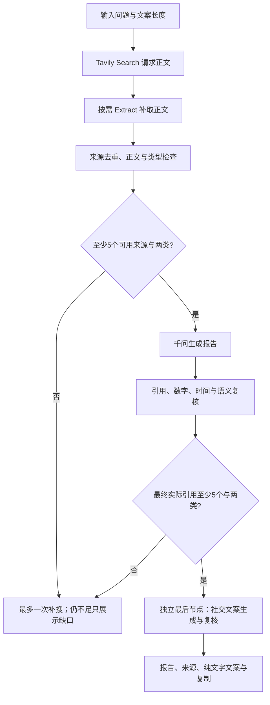

# Insight-to-Post · v0.2

输入问题，使用 Tavily 查找网页正文，千问生成并复核可追溯的研究报告，再输出可复制到 X 的中文文案。页面保留“读懂问题”的分析报告，并新增“表达与分享”的独立文案板块。

正式报告与社交文案分别要求至少 5 个实际使用、去重、相关、有正文的信源，并覆盖至少两类。来源不足时明确说明；搜索命中数量、输入模型的资料数量和最终引用数量分别统计。

## 启动

需要 Node.js 22/24 LTS、npm、千问和 Tavily 各自的有效密钥。Windows 在项目目录运行：

```powershell
powershell -ExecutionPolicy Bypass -File .\start.ps1 -Production
```

启动脚本会调用 `scripts/configure.mjs`，从 `key.txt` 中识别服务归属并填入缺失的 `.env.local` 配置，保留已有配置。建议文件使用两行明确配置：

```dotenv
QWEN_API_KEY=自己的千问密钥
TAVILY_API_KEY=自己的Tavily密钥
```

支持识别 `sk-` 千问密钥与 `tvly-` Tavily 密钥；同一服务存在多个候选时停止并要求明确配置，不把任意第一条密钥当作搜索凭证。密钥只用于后端，不打印、不提交、不随交付打包。当前工作区已完成密钥配置和 Tavily 官方 API 鉴权验证。

也可以复制 `.env.example` 为 `.env.local`，分别填写两项密钥，然后：

```powershell
npm ci
npm run dev
```

打开 [本机页面](http://localhost:3001)。本工作区的 3000 端口已有另一个本机服务，v0.2 默认使用 3001；`start.ps1 -Port 3002` 可以更换端口。手机与电脑连接同一 Wi-Fi，使用启动脚本显示的局域网地址；电脑服务需要保持运行。局域网 HTTP 的自动剪贴板权限可能不可用，文案板块提供手动全选复制入口。

## 研究与文案流程



Search 使用 `advanced`、10 个候选、`include_raw_content: markdown`，不使用 Tavily 合成答案作为引用。正文缺失时按 URL 补取，最多两次搜索（首轮加一次补充），按实际返回记录 credits。短搜索摘要不用于卡片。千问只负责生成与复核，不挂载内置搜索工具。

证据段落由后端编号，模型选择来源与段落 ID，服务器映射原文引用。数字、单位、年份和样本口径先经规则检查，再由模型辅助语义复核。复核删除内容后重算最终来源数，引用不足最多修正一次，仍不足返回 `insufficient`，不输出正式事实总结或卡片。

报告的 `complete` 与 `partial` 都必须满足来源门槛；`partial` 表示已达标但没有量化卡片或部分结论被删除。`complete` 表示本工具的校验通过，不代表结论绝对正确。来源分类使用有限的已知域名，未知类型明确标注；相同原文的镜像、重复转载和同一 URL 的多个片段合并计数。

## 社交媒体文案与复制

文案节点只接收最终保留的报告、依据与局限。采用参考文案的叙述结构：有依据的反差或变化吸引兴趣，短段落展开背景和具体过程，结尾联系读者处境、引起共鸣与讨论。结尾表达交给模型，不强制问句或问号，不因文风选择拒绝；仍检查事实、来源、格式与长度。风格示例中的 NaiveAI、AI4AI 和相对日期不自动作为事实输入。

页面提供两种目标长度：叙述长文（2000 加权字符，需要 X 账号支持长帖）与标准短帖（280 加权字符）。默认选择叙述长文，以保留参考文案的叙述节奏。后端使用 `twitter-text` 检查 X 加权长度，超长先修正；仍超长或证据不合格时不启用复制，不强行截断。

文案逐段关联已核验结论与原文依据，并独立复核事实、范围、因果与每个来源的实际支持关系。至少 5 个有效来源及两类的要求不能直接继承报告的计数。文案失败时报告仍可阅读，单独重试不重复搜索。

一键复制仅写入纯文字正文，段间一个空行，不含 Markdown、内部引用 ID、界面标签或模型说明。只有剪贴板成功才显示“已复制”；失败显示手动文字区域。Windows 剪贴板会将 LF 转为 CRLF，粘贴后的段落和空行保持一致。

系统不登录或代发到 X/小红书。用户自行粘贴、核对账号限制并发布；一键复制不等于原题的平台发布验收。

## 接口与配置

`POST /api/analyze`：`{ idea: string, socialTargetLength?: 280 | 2000 }`。报告状态、`coverage`、逐 URL 来源状态、`socialContent`、诊断与限时文案重试凭据一起返回。输入限制 5～1000 字；业务证据不足为 HTTP 200，配置/鉴权错误为 503，额度限制 429，超时 504。

`POST /api/social-content`：`{ token: socialRetryToken }`。凭据包含签名的已核验报告及引用片段、目标长度，两小时有效。服务端验证签名、时限与来源门槛后只运行文案节点；拒绝被客户端修改的报告。每个接口在单进程内最多两个并发任务。报告保存在当前页面状态中，刷新不保证恢复。

配置字段：

```dotenv
QWEN_API_KEY=自己的千问密钥
QWEN_BASE_URL=https://maas.qianwenaiapi.com/compatible-mode/v1
QWEN_MODEL=qwen3.8-flash
QWEN_TIMEOUT_MS=150000
TAVILY_API_KEY=自己的Tavily密钥
TAVILY_BASE_URL=https://api.tavily.com
TAVILY_TIMEOUT_MS=60000
X_TARGET_LENGTH=280
# 可选；未配置时以服务器千问密钥签名
# SOCIAL_SNAPSHOT_SECRET=自己的随机服务器密钥
```

`X_TARGET_LENGTH` 是未提供请求长度时的后端默认值；页面会传入所选的 280 或 2000。所有密钥不使用 `NEXT_PUBLIC_` 前缀。配置、请求和重试数据不会写入公开日志；实测文件位于已忽略的 `.local`。

## 验证与交付

```powershell
npm run test
npm run typecheck
npm run build
# 服务启动后验证界面和复制，不调用真实模型
npm run test:ui
npm run test:ui:social
# 真实 API 调用，会产生 Tavily 和千问用量
npm run verify:live
node scripts/verify-ui-live.mjs
```

测试覆盖来源与证据隔离、去重、最终来源门槛、复核后的来源不足、文案事实和格式校验、签名重试、剪贴板权限失败与新问题清除旧文案。结果和手机视角演示见 [验收记录](./验收记录.md)，范围与规则见 [MVP 开发计划](./MVP开发计划.md)。物理手机的人工检查与浏览器手机模拟分别记录。

当前验证：54 项测试、类型检查与生产构建通过，新增结尾标点、陈述结尾及组合总结中不同指标范围的回归；真实浏览器响应中报告和社交文案各实际引用 5 个来源、覆盖两类。交付包含 [63 秒手机视角演示](./artifacts/mobile-demo-v02.webm)、[真实响应](./artifacts/example-live-report-v02.json) 与 [纯文字文案](./artifacts/social-post-v02.txt)。真手机人工验收尚待确认。

设计取舍见 [可编辑原稿](./设计决策说明.md) 与 [两页 PDF](./output/pdf/设计决策说明-v02.pdf)。复制检查还包括取消后的迟到响应隔离及实际局域网 HTTP 下的手动全选路径；可设置 `TEST_HTTP_BASE_URL` 为局域网地址后运行 `npm run test:ui:social` 复现后者。

生成与复核使用同一模型，仍可能出现翻译、范围判断和来源可信度错误，请结合原文核验。流式响应、其他图表模板、生图/PNG 导出、账号登录、数据库、PWA 和平台直接发布仍暂缓。

接口依据：[Tavily Search](https://docs.tavily.com/documentation/api-reference/endpoint/search)、[Tavily Extract](https://docs.tavily.com/documentation/api-reference/endpoint/extract)、[X 字符计数](https://docs.x.com/fundamentals/counting-characters)。
